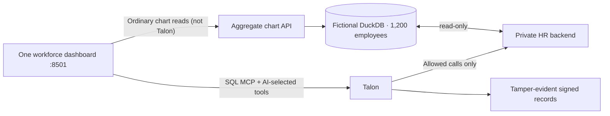

# People Analytics · 15-minute technical demo

**Thesis:** existing HR data is governed; Talon controls AI requests and MCP actions routed through its boundary, with signed evidence of decisions.

| Time | Demonstration | Proof |
|---|---|---|
| 0–2 | Run `infra`; inspect actual DuckDB row count and schema | Existing data infrastructure |
| 2–5 | Run `config`; review/edit YAML; enter provider key; `talon` | Live, understandable policies + process startup |
| 5–7 | Run `app`; input an approved aggregate SQL statement | Talon MCP allow + HR aggregate |
| 7–9 | Ask AI to interpret attrition from a tool | Real LLM only if provider smoke passed; inspect `llm.gateway.*` |
| 9–11 | Request privileged export | Talon pre-dispatch deny + unchanged HR export counter |
| 11–13 | Remove `hr_aggregate_sql` from proxy allowlist; `reapply`; rerun unchanged SQL | **Only Talon configuration changed the outcome** |
| 13–15 | Restore permission; show logs, HR counters, signed evidence | Repeatability and independent verification |

A manual, invalid employee-level SQL query is rejected by **HR SQL validation**. This is a separate boundary from Talon's MCP deny. The workforce charts use the ordinary aggregate API rather than the Talon gateway.

The earlier legacy direct HR export can still be demonstrated from a privileged backend terminal, but its success is not a "Talon disabled" state or permission migration. The presenter never claims Talon protects direct traffic it does not intercept.

No real employee data, production identity/RBAC, broad SQL support, comprehensive PII protection or regulatory compliance is demonstrated. Provider inference is separately verified using an opt-in paid smoke.
