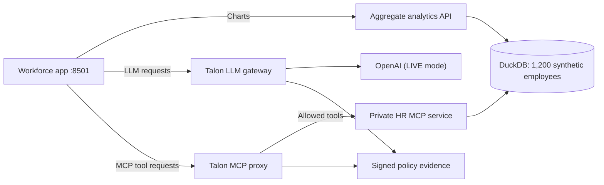

# Add Talon to a People Analytics application

This example begins with an ordinary workforce application: **DuckDB** stores 1,200 fictional employee records, a read-only analytics API serves the charts, and the application can ask an LLM about workforce trends. The next step is to control which models and HR operations its AI functionality can use.

Talon is introduced **between the application and its model/MCP endpoints**. We keep the database and chart API as they are; we do not give the AI application raw DuckDB access.

## The existing application



The chart API does **not** pass through Talon. Docker networking and filesystem mounts, not Talon, keep the app away from the private HR service and database. The HR backend validates any SQL it executes. Talon enforces permissions on the model and MCP requests routed through it.

All employee records are fictional. Run the commands below from a trusted Linux host with Docker Compose v2, OpenSSL, and a compatible Talon binary installed (for example, `go install github.com/dativo-io/talon/cmd/talon@latest`).

## 1. Start DuckDB and the existing analytics services

From the demo repository:

```bash
cd cases/people-analytics-copilot
export HR_DEMO_TALON_BIN="$(command -v talon)"

# Local secrets for the Talon vault, audit signatures and admin access.
# .env is ignored by Git; it contains no OpenAI key.
umask 077
printf 'HR_DEMO_SECRETS_KEY=%s\nHR_DEMO_SIGNING_KEY=%s\nHR_DEMO_ADMIN_KEY=%s\n' \
  "$(openssl rand -hex 32)" "$(openssl rand -hex 32)" "$(openssl rand -hex 24)" > .env

mkdir -p .state/policy .state/talon
docker compose -f compose.isolated.yaml up --build -d seed hr-server dashboard
docker compose -f compose.isolated.yaml exec -T hr-server python3 warehouse.py status
```

DuckDB is an **embedded file**, not a database server. The `hr-server` service has read-only access to it; the separate `dashboard` service exposes fixed aggregate charts. At this point, the LLM/MCP portion has not been connected to Talon.

## 2. Initialize Talon and configure the AI use case

We use Docker to put the Talon CLI on the correct application network. The commands themselves are the **normal Talon CLI**, not an initialization script.

```bash
docker compose -f compose.isolated.yaml run --rm talon-cli talon init --scaffold --name hr-analytics-assistant

# The scaffold is real. Start with the app-specific example policies, then edit them.
cp agent.talon.yaml .state/talon/agent.talon.yaml
cp proxy.isolated.talon.yaml .state/policy/proxy.isolated.talon.yaml
cp gateway.talon.yaml .state/policy/gateway.talon.yaml
${EDITOR:-vi} .state/talon/agent.talon.yaml
${EDITOR:-vi} .state/policy/proxy.isolated.talon.yaml

docker compose -f compose.isolated.yaml run --rm talon-cli talon validate
docker compose -f compose.isolated.yaml run --rm talon-cli talon secrets set \
  hr-analytics-assistant-talon-key talon-hr-demo-key-0001
```

The three relevant files are:

| File | Why it exists |
|---|---|
| `.state/talon/agent.talon.yaml` | Agent identity, tool capabilities, model routing, budgets and audit settings |
| `.state/policy/proxy.isolated.talon.yaml` | Which MCP tools can reach the private HR service |
| `.state/policy/gateway.talon.yaml` | OpenAI endpoint and secret name for model requests |

Review `allowed_tools` and `forbidden_tools` in the MCP policy. The default configuration permits headcount, attrition, tenure and **two reviewed aggregate SQL shapes**. It blocks `hr_employee_export`.

If you want genuine OpenAI inference, enter a **disposable API key** and store it in Talon's encrypted vault:

```bash
read -rs -p "OpenAI API key: " OPENAI_API_KEY; echo
docker compose -f compose.isolated.yaml run --rm talon-cli talon secrets set openai-api-key "$OPENAI_API_KEY"
unset OPENAI_API_KEY
```

The CLI's `secrets set` command accepts a positional value: Docker administrators may see the argument while the setup container runs. Use this convenience path only with synthetic data and a disposable key, not production HR credentials.

## 3. Start Talon and connect the application

For real model calls, start both the MCP proxy and LLM gateway:

```bash
docker compose -f compose.isolated.yaml --profile live up -d talon-mcp talon-gateway
HR_DEMO_AI_MODE=live docker compose -f compose.isolated.yaml up --no-deps -d ui
```

Open **http://127.0.0.1:8501**. Its charts remain backed by DuckDB. SQL requests now invoke the `hr_aggregate_sql` MCP tool through Talon, and the AI questions use Talon's OpenAI-compatible gateway.

In another terminal (from this same directory, with `HR_DEMO_TALON_BIN` exported):

```bash
docker compose -f compose.isolated.yaml logs -f talon-mcp talon-gateway hr-server ui
```

This includes Talon process output and the application's separately labeled `HR_AI_TRACE` events. The latter describe requests observed at the application/Talon boundary, **not** a packet capture inside OpenAI. Full prompt and response bodies are not logged by default.

No OpenAI key? Start `talon-mcp` alone, then start `ui` with the default **GUIDED · NO LLM** mode. SQL/MCP policy and signed evidence are still real, but the guided assistant uses deterministic wording. Don't present guided results as model-generated.

## 4. See how policy changes execution

Keep the browser open and use the SQL workspace's first example:

```sql
SELECT department, COUNT(*) AS employees
FROM employees
GROUP BY department
ORDER BY department;
```

It executes through `hr_aggregate_sql`, and Talon returns a committed allow receipt. Now remove **only** this line from `.state/policy/proxy.isolated.talon.yaml`:

```yaml
    - name: hr_aggregate_sql
```

Validate the agent policy and restart the MCP process so it loads the edited proxy policy:

```bash
docker compose -f compose.isolated.yaml run --rm talon-cli talon validate
docker compose -f compose.isolated.yaml up --no-deps -d --force-recreate talon-mcp
```

Submit **the identical SQL** again. Talon now denies the MCP operation before dispatch. Neither the workforce application nor the HR backend changed. Restore the line, recreate `talon-mcp`, and the query works again.

Compare that with an individual-salary SQL query such as `SELECT full_name, monthly_salary_mxn FROM employees`. Talon may allow the **tool invocation**, but the HR backend rejects the SQL because it is not one of the reviewed aggregate shapes. A Talon denial, an HR SQL rejection and Docker isolation are **different controls**.

## 5. Inspect the evidence

Use the native Talon audit commands:

```bash
docker compose -f compose.isolated.yaml run --rm talon-cli talon audit list
# Copy an evidence ID from a real allow/deny response:
docker compose -f compose.isolated.yaml run --rm talon-cli talon audit verify EVIDENCE_ID
```

The HR backend's independent execution counters are available with:

```bash
docker compose -f compose.isolated.yaml exec -T hr-server python3 verify_isolation.py counters
```

A denied MCP tool must have a signed **not-dispatched** receipt and must **not** increment the backend's execution counter. Calls that bypass Talon have no Talon evidence.

To stop the stack: `docker compose -f compose.isolated.yaml --profile live down`. The local `.state/` directory persists the Talon vault and evidence; deleting it destroys that local demo state.

## Tests and limitations

[Automated test coverage](CI_COVERAGE.md) includes Docker isolation, real Talon CLI/MCP behavior, Chromium and an actual allow→deny→allow policy edit. The external-provider check is opt-in and billable: from the repository root run `bash scripts/test-people-analytics-real-provider.sh` with `OPENAI_API_KEY` set.

This sample does not provide production HR IAM, row-level permissions, general SQL analysis, comprehensive PII protection or legal compliance determinations. Signed evidence is tamper-evident as long as the signing key is protected. The synthetic data/Plotly components come from [franciscomorenosys/hr-data-pipeline](https://github.com/franciscomorenosys/hr-data-pipeline), MIT licensed, commit `f0edfe24f2e29d02b4145e9e806c3ad0826b7f5b`; see `upstream_hr/LICENSE`.
