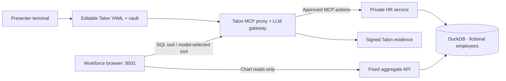

# People Analytics · live Talon configuration demo

**The HR warehouse is governed already. Talon governs what an AI use case may invoke, and creates verifiable evidence of routed decisions.**

**Synthetic data only.** Docker isolates the workforce app from the private HR service and DuckDB file. Talon governs only model and MCP calls routed through it. The HR backend, not Talon, validates SQL query shapes. Signed evidence is tamper-evident, not immutable.

The only browser application is **http://127.0.0.1:8501**. Presenter operations happen in the terminal; there is no admin web console.

## Architecture



The AI app cannot mount or directly reach DuckDB/private HR. The fixed chart API is not governed by Talon; the SQL workspace and AI tool requests go through MCP. The SQL executor accepts **only two reviewed department aggregate shapes**, with a minimum cohort. An invalid query is rejected by the HR backend, even if Talon allowed dispatch. A tool permission denied by Talon is **not dispatched**.

## Presenter sequence (trusted Linux host)

Requires Docker Compose v2, OpenSSL, an installed compatible `talon` binary, Python for the local tests, and a Git checkout of `feat/people-analytics-governed-demo`.

```bash
git switch feat/people-analytics-governed-demo
bash scripts/people-analytics-isolated.sh infra     # start + seed DuckDB and HR
bash scripts/people-analytics-isolated.sh config    # copy editable YAML to .state/policy
${EDITOR:-vi} cases/people-analytics-copilot/.state/policy/proxy.isolated.talon.yaml

# Enter a real OpenAI key securely (no credential in a tracked YAML file).
read -rs -p "OpenAI key: " OPENAI_API_KEY; echo; export OPENAI_API_KEY
bash scripts/people-analytics-isolated.sh talon     # visible init, validation, MCP, gateway
unset OPENAI_API_KEY
bash scripts/people-analytics-isolated.sh app       # one workforce dashboard
```

In a second terminal:

```bash
bash scripts/people-analytics-isolated.sh logs
```

The demo's initial Talon key is a synthetic fixed value; the actual provider key is stored in the Talon vault. The convenience Docker setup briefly passes the provider key through an init-container environment: **only use a disposable key on a trusted synthetic-demo host**; Docker administrators can inspect container environments.

For a **no-key CI rehearsal only**, `bash scripts/people-analytics-isolated.sh up` launches GUIDED mode. It executes real Talon MCP but uses **no LLM**. `bash scripts/people-analytics-isolated.sh live` requires `OPENAI_API_KEY`. Do not claim real OpenAI execution until the [paid smoke](ADVANCED_SETUP.md) passes.

## Policy-change proof: same application, same SQL, different decision

1. Run the default department-headcount SQL in the browser. Observe `EXECUTED`, Talon allow receipt and HR execution.
2. Remove **only** `- name: hr_aggregate_sql` from `.state/policy/proxy.isolated.talon.yaml`.
3. Run `bash scripts/people-analytics-isolated.sh reapply`. This validates/restarts the relevant Talon services; the browser and HR code are unchanged.
4. Submit **exactly the same SQL** again. The result must be `DENIED · Talon blocked before dispatch`. Check the independent HR counter did not increment.
5. Restore the permission, `reapply`, repeat SQL and verify signed receipts. CI executes this policy flip automatically.

```bash
# Check HR's independent dispatcher counters (not a Talon UI assertion)
docker compose -f cases/people-analytics-copilot/compose.isolated.yaml \
  --env-file cases/people-analytics-copilot/.state/isolated.env \
  exec -T hr-server python3 verify_isolation.py counters
# Inspect and verify Talon's evidence (inside its configured state)
docker compose -f cases/people-analytics-copilot/compose.isolated.yaml \
  --env-file cases/people-analytics-copilot/.state/isolated.env \
  exec -T talon-mcp talon audit list
```

A separate **operator-triggered export probe** through Talon must deny pre-dispatch. It is not proof the model autonomously asked for that export. The legacy privileged direct HR path bypasses Talon; it can be reproduced separately in the [terminal commands](PRESENTER_COMMANDS.md), never disguised as a Talon toggle.

## Documentation

- [Presenter terminal commands](PRESENTER_COMMANDS.md)
- [One-browser walkthrough](UI_PLAYBOOK.md)
- [15-minute demo story](PEOPLE_ANALYTICS_DEMO_PLAN.md)
- [External provider smoke and tracing](ADVANCED_SETUP.md)
- [CI acceptance and limitations](CI_COVERAGE.md)

Source-pinned fictional HR fixture and Plotly helpers derive from the MIT-licensed [franciscomorenosys/hr-data-pipeline](https://github.com/franciscomorenosys/hr-data-pipeline), commit `f0edfe24f2e29d02b4145e9e806c3ad0826b7f5b`; see `upstream_hr/LICENSE`.
