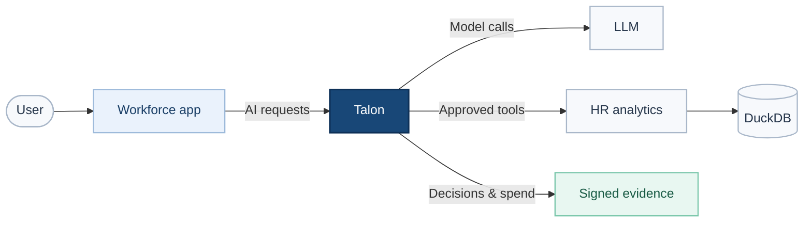
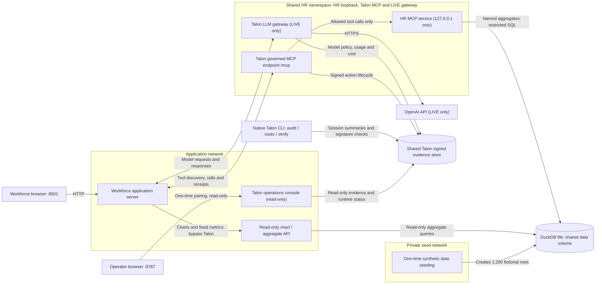
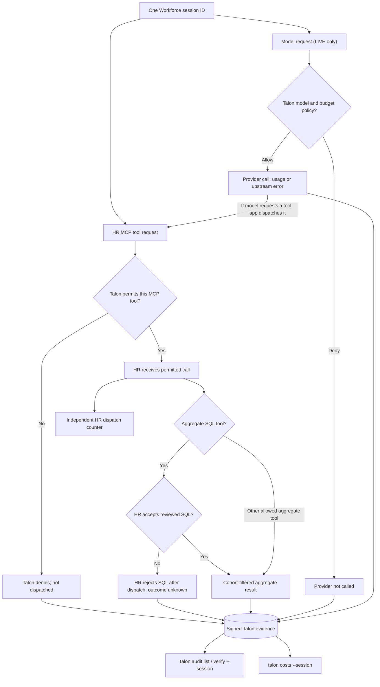

# People Analytics — technical reference

> **Looking to run this demo?** Follow the [complete operator playbook](PLAYBOOK.md): current Talon `main`, setup, GUIDED/LIVE, pairing, evidence, troubleshooting, and safe shutdown. **This document is supplementary architecture, verification, and historical test evidence**, not a step-by-step quickstart.

## Talon at a glance



**What changes with Talon:** AI model calls and HR tool requests run through its policy boundary. Talon can allow aggregate analysis, deny the individual-employee export tool, and record signed decisions and session spend. The existing charts use a separate read-only analytics path and **do not** go through Talon. Talon never queries DuckDB directly.

This example begins with an ordinary workforce application: **DuckDB** stores 1,200 fictional employee records, a read-only analytics API serves the charts, and the application can ask an LLM about workforce trends. The next step is to control which models and HR operations its AI functionality can use.

Talon is introduced **between the application and its model/MCP endpoints**. We keep the database and chart API as they are; we do not give the AI application raw DuckDB access.

## Governed MCP integration on Talon main

**Current demo target:** the current `dativo-io/talon` `main` revision resolved at run time. CI and the [operator playbook](PLAYBOOK.md) build the checked-out source and record the source SHA; neither requires a permanently pinned commit. This is **source-built acceptance**, not verification of a published stable binary. The application calls `POST /mcp`; the HR backend is declared as the trusted `actions.sources.hr`. Removed `--proxy-config` and `/mcp/proxy` interfaces are not used.

The read-only aggregate tools execute in one governed call; `hr_employee_export` is forbidden and must have zero HR dispatches. HR SQL rejected **after dispatch** is `UNKNOWN`, not an invented policy denial. Confirm the positive aggregate, negative export, SQL UNKNOWN, hot reload, independent HR counters and verified signed action lifecycle using `scripts/test-people-analytics-talon.sh`. The browser and isolated Docker Compose gates are separate: each run records the actual source SHA and must pass together to support a demo. `X-Talon-Session-ID` is attribution, not authorization. The model remains synthetic unless the opt-in paid-model path is run.

The published-RC2 evidence below is a **historical control for the former pre-convergence architecture**, not acceptance of this upgraded demo.

## RC2 compatibility and released-artifact evidence

The [published Talon `v1.17.0-rc.2` prerelease](https://github.com/dativo-io/talon/releases/tag/v1.17.0-rc.2) is the immediate Full Demo integration target; tag commit `3f3f20dff910dc2416c8d82467de2d4e2dd8acc5`, Linux/amd64 archive SHA256 `5ba2021a7da0ad704a4c3b21e319e05b96fa0347d7d43318ed30bead357ba47c`. [HR RC2 tagged-source CI](https://github.com/dativo-io/talon-full-demo/actions/runs/44882091277) **passed** MCP model/policy and independent HR guard tests with a source-compiled executable; it is not the official archive. The [Full Demo RC2 published-binary consumer workflow](https://github.com/dativo-io/talon-full-demo/pull/52) must independently run against the verified archived executable. The HR **seven-area paired Console browser** and **shared persistent two-app adoption** are not yet completed in this PR. This distinction is mandatory for demos.

## Skeptical buyer comparison and truthful proof

**Buyer objection:** "Bifrost, Portkey and TrueFoundry already allow per-agent MCP tool permissions; Solo can impose MCP policy, and LiteLLM grants tools per key/team. Why introduce Talon to my HR application?"

**Winning answer to demonstrate, not simply say:** keep the existing DuckDB/HR SQL authorization intact; route only selected AI model/MCP requests through Talon; allow `hr_headcount_summary`, reject the employee-export MCP tool *before upstream dispatch*, then separately prove the HR SQL server still rejects a prohibited query even if a permitted MCP tool is called incorrectly. Attribute each intervention to its actual enforcement point. Verify one session with Talon's signed policy/evidence and an independent HR call counter. A fixed local chart or direct DuckDB query is outside Talon, and must be labeled accordingly.

| Required proof | Concrete independent observation | Status in this PR |
| --- | --- | --- |
| Useful pre-existing app result | Existing workforce browser + DuckDB aggregate, no fake analytics | Existing fixture/CI covers |
| Talon MCP tool governance | One allowed aggregate; forbidden export: **zero** HR dispatch; actual runtime signed receipt | Isolated fixture/CLI contract passes |
| Backend defense in depth | Prohibited SQL fails at HR backend even if the MCP request itself is allowed | Isolated fixture contract |
| One organization policy shared with another app | One `talon.config.yaml` company rule; native HR + existing Customer Support distinct keys, loaded effective policy, observed traffic and identical applicable denial; first app remains working | **NOT RUN** in shared persistent deployment; owned by #48/#50 |
| Seven-area read-only Console | Actual paired browser across Overview / AI Use Cases / Approvals / Sessions / Costs / Configuration / System, source parity and safe redaction | **NOT RUN** on complete published 1.17.0 |
| Published artifact handoff | Exact official tag + checksum/digest and clean customer onboarding | **NOT RUN** on complete published 1.17.0 |

**Competitive test:** ask the buyer to reproduce that *two-app* policy reuse in Bifrost, Portkey or TrueFoundry—not merely one denied MCP tool. If Talon requires a second policy engine or manual policy duplication, it has not won the claimed company-control-plane value. Do not claim competitors lack tool filtering, signing or governance. See the [approved five-competitor scorecard](https://github.com/dativo-io/talon-full-demo/blob/docs/acme-release-aligned-showcase/docs/COMPETITOR_PROOF_SCORECARD.md) and [buyer-win strategy](https://github.com/dativo-io/talon-full-demo/blob/docs/acme-release-aligned-showcase/docs/TALON_BUYER_WIN_STRATEGY.md).

## Customer integration recipe

**Company-first adoption:** establish `talon.config.yaml` company policy before registering the HR AI use case. One use case = one `agent.talon.yaml`, identity and active Talon key. Prefer the merged core-main native registration path (`talon agents add <name> --owner <team>`; verify released flags after publication) and verify its exact syntax before replacing the existing standalone fixture instructions. The latter remain an older isolated topology, not verified native fleet onboarding. Prove registration, loaded policy/runtime identity, actual intercepted application traffic and governed outcome separately, using the real Console/CLI/API and independent HR counters. Do not claim a file edit or registration alone proves enforcement. For the short pilot/ACME, show the same applicable mandatory company control inherited by another use case, with first still operating. Measure prepared installation/pairing, integration and denied-action investigation time; record actual results, not targets as results.


- **Before Talon:** the Workforce web app renders fixed aggregate charts from a read-only analytics API over DuckDB.
- **Connect:** configure the application to use the Talon MCP endpoint and, in LIVE, the OpenAI-compatible Talon gateway; provision the application's Talon identity separately from the provider secret. Native initialization, validation, policy and activation steps follow below.
- **Company policy:** configure shared defaults and the use-case overlay via the supported release; explicitly restrict employee export and set the model budget. Inspect effective/loaded policy rather than assuming a file edit is active.
- **Governed:** routed model requests, MCP discovery and calls. **Not governed:** fixed charts, separate database access or other bypass paths. HR's independent SQL validation is not a Talon denial.
- **Value / verify:** useful aggregate answers with bounded capability access, visible decisions and usage; compare allow/deny/upstream rejection with HR counters, console, CLI/API and signature verification. Repeat a policy change without changing application source.
- **Adoption:** use verified stable artifact for customer-facing use; candidate acceptance is internal only. Log step, expected/actual behavior, workaround, adoption severity and linked issue (product: [OSS #533](https://github.com/dativo-io/talon/issues/533) / [#561](https://github.com/dativo-io/talon/issues/561); demo fixes here). Exercise documented persistent restart/recovery where practical without resetting state or keys; record NOT RUN if unavailable.

## The existing application



This shows the **server-side** boundaries, not direct browser connections to OpenAI or the HR backend. The **Workforce browser** reaches only the Workforce application on port 8501; a separate **operator browser** can pair with the read-only Talon operations console on host-loopback port 8787. Neither browser directly reaches the private HR service. The fixed chart API reads the DuckDB **file** via a read-only Docker volume without Talon. DuckDB is embedded, not a network database; the private HR service reads the same volume. The HR MCP service is the AI use case's **trusted MCP action source**: it listens on `127.0.0.1` inside a namespace shared by `talon-mcp` and the LIVE-only `talon-gateway`, because both Talon processes independently discover the HR action catalog at startup. Both reach the HR backend at `http://127.0.0.1:9091/mcp`; nothing else on the application network can call HR directly. Every tool call from the application goes to Talon's **governed MCP endpoint** (`POST /mcp`, talon#431) and is an Action Gateway operation: policy, at most one dispatch, signed lifecycle evidence. Talon governs intercepted model requests and these MCP actions, while the HR backend independently validates SQL. The gateway runs only in LIVE mode (the GUIDED path makes no model requests); credential-free CI uses a fake provider instead of external OpenAI. The two Talon processes share persisted signed evidence; `talon audit` and `talon costs` read that evidence, not browser-generated totals.

All employee records are fictional. Run the walkthrough from `cases/people-analytics-copilot` on a Linux host with Docker Compose v2, OpenSSL, Git, and Go.

**Compatibility:** the People Analytics policy requires governed MCP action support, including `read_only`. Talon v1.17.0-rc.2 is not compatible. The demo builds Talon from current `main` and validates it each run; no fixed SHA is required.

For a customer-facing demo, use a [published Talon release](https://github.com/dativo-io/talon/releases) **only after** it passes the same governed-MCP and Console acceptance checks. Do not silently substitute an older release or change the agent's permissions to make validation pass.

### Prepare Talon

Run these commands **from this directory** (`cases/people-analytics-copilot`) on the Ubuntu Docker host:

```bash
bash ../../scripts/prepare-people-analytics-talon.sh
export HR_DEMO_TALON_BIN="$(realpath ../../.state/talon-bin/talon)"
```

The helper prepares and checks a compatible Talon executable. It does not reset your existing configuration, secrets, or evidence. This is a source-built demo dependency until a compatible published release passes the same acceptance checks; the script resolves current Talon `main` instead of freezing a SHA.

If validation says `read_only: Additional property is not allowed`, Compose is using an incompatible executable. Re-run the helper and check the mounted version with:

```bash
bash ../../scripts/check-people-analytics-talon-binary.sh "$HR_DEMO_TALON_BIN"
docker compose -f compose.isolated.yaml run --rm talon-cli talon version
docker compose -f compose.isolated.yaml run --rm talon-cli talon ui serve --help
```

Removing `read_only` is not a valid workaround: it changes the tool's policy semantics.

If `talon doctor` reports `llm_keys: No LLM provider configured`, that is expected for the **GUIDED** deterministic tool demo: it makes **no model calls**. `talon validate` must still pass policy schema validation. LIVE model mode requires separately configuring an actual provider secret and Talon gateway; `talon doctor`'s LLM readiness check is not a substitute for checking policy compatibility. A standalone `agent.talon.yaml` without `talon.config.yaml` means there is **no company-level baseline** in this isolated case; use the [shared ACME fleet](../../scripts/test-acme-one-fleet.py) to prove four agent identities inheriting one company policy.

## 1. Start DuckDB and the existing analytics services

Continue from `cases/people-analytics-copilot` with `HR_DEMO_TALON_BIN` set as above:

```bash
# Local secrets for the Talon vault, audit signatures and admin access.
# .env is ignored by Git; it contains no OpenAI key.
# Generate keys ONCE. Keep the same .env as long as .state/talon exists.
# Re-generating keys over existing secrets.db breaks decryption; replacing
# the signing key also invalidates verification of existing signed evidence.
if [ ! -f .env ]; then
  if [ -e .state/talon/secrets.db ] || [ -e .state/talon/evidence.db ]; then
    echo "Existing Talon state but no .env: recover the original keys or follow the reset procedure below." >&2
    exit 1
  fi
  umask 077
  printf 'HR_DEMO_SECRETS_KEY=%s\nHR_DEMO_SIGNING_KEY=%s\nHR_DEMO_ADMIN_KEY=%s\nHR_DEMO_UID=%s\nHR_DEMO_GID=%s\n' \
    "$(openssl rand -hex 32)" "$(openssl rand -hex 32)" "$(openssl rand -hex 24)" "$(id -u)" "$(id -g)" > .env
else
  echo "Reusing existing .env: do not replace its keys while .state/talon contains data."
fi

mkdir -p .state/policy .state/talon
docker compose -f compose.isolated.yaml up --build -d seed hr-server dashboard
docker compose -f compose.isolated.yaml exec -T hr-server python3 warehouse.py status
```

DuckDB is an **embedded file**, not a database server. The `hr-server` service has read-only access to it; the separate `dashboard` service exposes fixed aggregate charts. At this point, the LLM/MCP portion has not been connected to Talon.

### Existing state: `cipher: message authentication failed`

If `talon-gateway` repeatedly exits while resolving `hr-analytics-assistant-talon-key`, or `talon-mcp` says the agent identity registry is unavailable, **the vault's encryption key and the current `.env` probably differ**. This is not a Docker build failure. Do not keep regenerating `.env`: `HR_DEMO_SECRETS_KEY` encrypts `secrets.db`; `HR_DEMO_SIGNING_KEY` verifies historical evidence. Changing either while keeping the original state has consequences.

**Preserve old sessions and evidence:** stop the Compose services, then restore the *original* `.env` (both secrets and signing keys) from your secure backup and restart. Do not paste key values into a log, issue or screenshot.

**Fresh synthetic demo, if the old keys cannot be recovered:** back up the Talon state before initializing a clean installation under the existing `.env`. This intentionally starts with a **new** vault, evidence history and session store; the old state remains in the backup folder.

```bash
# From cases/people-analytics-copilot; stop writers before touching state.
docker compose -f compose.isolated.yaml --profile live --profile operator down
backup=".state/talon.backup-$(date +%Y%m%d-%H%M%S)"
mv .state/talon "$backup"
mkdir -p .state/talon

# Use the SAME existing .env; do not run the key-generation snippet again.
docker compose -f compose.isolated.yaml run --rm talon-cli \
  talon init --scaffold --name hr-analytics-assistant
cp agent.talon.yaml .state/talon/agent.talon.yaml
docker compose -f compose.isolated.yaml run --rm talon-cli talon validate
docker compose -f compose.isolated.yaml run --rm talon-cli \
  talon secrets set hr-analytics-assistant-talon-key talon-hr-demo-key-0001
```

For **LIVE** mode, re-store the OpenAI provider secret in the new vault using the instructions below before starting `talon-gateway`; **GUIDED** mode needs no provider key. Keep the backup until any prior data you need is accounted for. Avoid `docker compose down -v`: it would also delete the DuckDB volume, which is unnecessary for this repair.

As an alternative when intentionally retaining the existing state, `talon secrets set` can overwrite individual ciphertext values using the current encryption key (the vault upserts without decrypting an old value). That only repairs the secrets you replace; it **does not recover old secret values or restore HMAC verification** if the original signing key was lost. For accurate screenshots and demo session evidence, prefer restoring both original keys or the clean backed-up state above.

## 2. Initialize Talon and configure the AI use case

We use Docker to put the Talon CLI on the correct application network, running under your host UID so the generated files remain editable. The commands themselves are the **normal Talon CLI**, not an initialization script.

```bash
# Check the version BEFORE creating or changing any state.
bash ../../scripts/check-people-analytics-talon-binary.sh "$HR_DEMO_TALON_BIN"
docker compose -f compose.isolated.yaml run --rm talon-cli talon version

# Init is one-time only. NEVER use --force on existing .state/talon.
# talon init also refuses when agent.talon.yaml is already present.
if [ ! -f .state/talon/agent.talon.yaml ]; then
  docker compose -f compose.isolated.yaml run --rm talon-cli \
    talon init --scaffold --name hr-analytics-assistant
  cp agent.talon.yaml .state/talon/agent.talon.yaml
else
  echo "Keeping existing HR agent policy, vault and evidence; skipping init."
fi

# Preserve existing gateway changes; don't clobber a live provider configuration.
if [ ! -f .state/policy/gateway.talon.yaml ]; then
  cp gateway.talon.yaml .state/policy/gateway.talon.yaml
fi
${EDITOR:-vi} .state/talon/agent.talon.yaml

docker compose -f compose.isolated.yaml run --rm talon-cli talon validate
docker compose -f compose.isolated.yaml run --rm talon-cli talon secrets set \
  hr-analytics-assistant-talon-key talon-hr-demo-key-0001
```

### If this is an existing demo installation

Do **not** repeat `talon init --scaffold` once `.state/talon/agent.talon.yaml` exists; `already exists` is an expected guard, not proof that initialization failed. If you copied the current policy into that state while using an older binary, the correct repair is to **change the mounted binary**, not to delete `read_only`, reset the vault, change signing keys or overwrite the agent file. Once the mounted binary prints the pinned version, run:

```bash
docker compose -f compose.isolated.yaml run --rm talon-cli talon validate
docker compose -f compose.isolated.yaml --profile operator up -d --force-recreate talon-mcp
```

Restart any additional Talon gateway/Console service you have enabled to ensure it uses the same new binary. If the source pin differs in your checkout, run `git pull` on the Full Demo repository first and rebuild with the helper. The demonstration key `talon-hr-demo-key-0001` and the default allow-all secret ACL are **only for a disposable single-use-case demo**; never use them for production tenants.

The two relevant files are:

| File | Why it exists |
|---|---|
| `.state/talon/agent.talon.yaml` | Agent identity, the HR MCP action source and its declared actions, forbidden tools, model routing, budgets and audit settings |
| `.state/policy/gateway.talon.yaml` | OpenAI endpoint and secret name for model requests |

The choices matter because they change behavior. In `agent.talon.yaml`, `agent.key.secret_name` binds requests to this AI use case; `capabilities.allowed_tools` names the capabilities it is meant to have; `policies.cost_limits` bounds per-request, daily and monthly model expenditure; `policies.session_limits.max_cost: 0.10` caps spending by the browser's Talon session (in the configured pricing currency); and `audit.include_prompts: false` avoids storing raw prompts. `actions.sources.hr` declares the HR MCP server as this use case's trusted action source and `actions.definitions` declares each tool the application may call: only a declared action can reach the HR backend. The four aggregates are marked `read_only: true` (no side effect, so an allowed call runs in one MCP request); `hr_employee_export` is declared but listed in `capabilities.forbidden_tools`, so Talon hides it from discovery and denies it before dispatch when it is called by name. The gateway file names the OpenAI endpoint and its **vault secret reference**, rather than embedding the provider key.

These restrictions are complementary: the SQL tool is callable only when Talon allows it, and the HR service independently accepts two standard department-count aggregates plus a strictly limited `department LIKE '%Customer%'` filter. The filter is bound as a SQL parameter, subject to minimum-cohort enforcement. Arbitrary SQL, joins, employee-level projections and additional clauses are not accepted.

If you want genuine OpenAI inference, enter a **disposable API key** and store it in Talon's encrypted vault:

```bash
read -rs -p "OpenAI API key: " OPENAI_API_KEY; echo
docker compose -f compose.isolated.yaml run --rm talon-cli talon secrets set openai-api-key "$OPENAI_API_KEY"
unset OPENAI_API_KEY
```

The CLI's `secrets set` command accepts a positional value: Docker administrators may see the argument while the setup container runs. Use this convenience path only with synthetic data and a disposable key, not production HR credentials.

## 3. Start Talon and connect the application

The Talon containers use a small Debian image with the system `ca-certificates` bundle. The bare `debian:bookworm-slim` image does not reliably provide that bundle, which can cause OpenAI requests to fail with `x509: certificate signed by unknown authority`. Rebuild Talon's image after upgrading. If your network intercepts HTTPS, install your organization's trusted root CA **in addition** to the standard CA bundle; never turn TLS verification off.

For real model calls, start Talon's governed MCP endpoint and the LLM gateway **in the foreground** so their actual `talon serve` output remains visible:

```bash
docker compose -f compose.isolated.yaml --profile live up --build --force-recreate talon-mcp talon-gateway
```

**Why the LIVE gateway must join the HR namespace:** both `talon-mcp` and `talon-gateway` compile the same use-case agent policy and discover its trusted HR MCP source at `http://127.0.0.1:9091/mcp` on startup. In older Compose definitions the gateway was attached directly to `app_net` instead. Its loopback address then pointed to an empty gateway namespace, causing `server/discover: dial tcp 127.0.0.1:9091: connect: connection refused`, despite `talon-mcp` working. Both Talon services now share the `hr-mcp-net` network namespace, have separate app-facing DNS names `talon-mcp:8080` and `talon-gateway:8082`, and wait for the private HR server's health check. **The HR MCP port 9091 stays loopback-only.** No HR database or MCP endpoint is exposed to `app_net`.

To repair an already-running LIVE installation after pulling the fix, **keep `.env` and `.state/talon` unchanged**; ensure `HR_DEMO_TALON_BIN` still points to the verified pinned executable, then from this directory run:

```bash
docker compose -f compose.isolated.yaml --profile live up -d --force-recreate \
  hr-mcp-net hr-server talon-mcp talon-gateway ui
docker compose -f compose.isolated.yaml --profile live logs --tail=30 talon-gateway
```

This requires the LIVE model provider secret and `gateway.talon.yaml` setup above; it does not provision real OpenAI access by itself. **GUIDED mode needs no model provider and no LIVE gateway:** omit `--profile live` and start `talon-mcp talon-ui ui` with `--profile operator` instead. To stop an old failing LIVE gateway while keeping the governed MCP and Console, run `docker compose -f compose.isolated.yaml stop talon-gateway`.

In another terminal, from this same directory and with `HR_DEMO_TALON_BIN` exported:

```bash
export HR_DEMO_TALON_BIN="$(realpath ../../.state/talon-bin/talon)"
HR_DEMO_AI_MODE=live docker compose -f compose.isolated.yaml up --no-deps -d ui
# Separate read-only operator view; does not restart the gateway or the MCP endpoint.
docker compose -f compose.isolated.yaml --profile operator up -d talon-ui
```

Open **http://127.0.0.1:8501**. Its charts remain backed by DuckDB. SQL requests invoke the `hr_aggregate_sql` MCP tool through Talon, and AI questions use Talon's OpenAI-compatible gateway.

You can also follow the HR backend and application traces with `docker compose -f compose.isolated.yaml logs -f hr-server ui`. The actual Talon commands are declared in `compose.isolated.yaml`: `talon serve` (the governed MCP endpoint for the use case in `/state/agent.talon.yaml`) and `talon serve --gateway --gateway-config ...`. `talon serve` discovers the HR action source when it starts and refuses to start if HR is unreachable; Compose starts `talon-mcp` only after HR's health check passes.

This includes Talon process output and the application's separately labeled `HR_AI_TRACE` events. The latter describe requests observed at the application/Talon boundary, **not** a packet capture inside OpenAI. Full prompt and response bodies are not logged by default.

No OpenAI key? Run `docker compose -f compose.isolated.yaml --profile operator up --build -d talon-mcp talon-ui ui` (after the initialization in step 2). The Workforce app starts in **GUIDED · NO LLM** mode. SQL/MCP policy and signed evidence are still real, but the guided assistant uses deterministic wording. Don't present guided results as model-generated.

### Open Talon's read-only operator console (recommended when explaining a decision)

The two UIs have different jobs. **Workforce app** at [127.0.0.1:8501](http://127.0.0.1:8501/) makes AI/HR requests and shows the synthetic workforce charts. **Talon operations console** at [127.0.0.1:8787](http://127.0.0.1:8787/) explains what Talon saw: runtime status, current versus loaded policy, session evidence, denials, and costs. The console never sends requests to the HR backend or changes policy.

```bash
# Run from cases/people-analytics-copilot, with HR_DEMO_TALON_BIN set.
# Start the read-only Console without exposing it beyond host localhost.
docker compose -f compose.isolated.yaml --profile operator up -d talon-ui

# Check that it is running. If not, see "Troubleshooting" below.
docker compose -f compose.isolated.yaml --profile operator ps talon-ui

# Request a NEW code. IMPORTANT: this command prints a confirmation,
# NOT the pairing code; the running Console prints the code to its own stdout.
docker compose -f compose.isolated.yaml --profile operator exec -T talon-ui talon ui pair

# Read the code locally from the Console container's log.
# Run promptly; the most recent "Talon console pairing code:" is the valid one.
docker compose -f compose.isolated.yaml --profile operator logs --no-color --tail=30 talon-ui
```

**Expected log line:** `Talon console pairing code: XXXXX-XXXXX-XXXXX-XXXXX` (the X characters illustrate the *format*, not a working code). Enter the **most recent actual code**, not the command's `Asked console process ...` confirmation. Generating a new code invalidates the previous unredeemed code. `up -d` only reports container startup; it **never prints pairing credentials in your terminal**.

**Troubleshooting — no pairing code in the logs:** check `docker compose -f compose.isolated.yaml --profile operator ps -a talon-ui` and `docker compose -f compose.isolated.yaml --profile operator logs --tail=100 talon-ui`. If the Console exited, fix the logged startup error (such as missing `/state/evidence.db`), make sure `talon-mcp` has started, and recreate `talon-ui`. If `talon ui pair` says `no running console found` or `console process ... not reachable`, inspect/restart the `talon-ui` container; do not try `talon ui pair` from the host or from `talon-cli` because it must signal the **running Console process inside `talon-ui`**. The pair command itself never outputs the code.

Open **http://127.0.0.1:8787/** and enter the fresh, single-use pairing code. The browser gets a **read-only session cookie**, not an admin, provider, vault or agent key. Do not expose this port beyond localhost or publish pairing codes in screenshots or shared logs. The **`operator` Compose profile** keeps the console opt-in. The Compose service mounts the **same Talon state and policy files**, but runs on `app_net` only (no `private_hr` network); only the evidence **signing** key is passed to it for HMAC verification.

**Remote Ubuntu host:** port `8787` is intentionally bound to **the server's loopback**, so the Console isn't directly reachable from a laptop. Start `ssh -L 8787:127.0.0.1:8787 <user>@<server-ip>` in your laptop's terminal, then visit `http://127.0.0.1:8787/` **on the laptop**. Keep the one-time code private; do not add it to the README, screenshots, tickets or GitHub Actions logs.

**First operator check — Overview:** distinguish installation readiness from use-case attention. Select **AI Use Cases → hr-analytics-assistant → Summary** to show its actual identity, policy and available activity. Fresh traffic history is not proof of health. In **Configuration**, inspect the organization/use-case settings and the current versus loaded generation (only claim activation when proven).

**Current-main Console check — Approvals:** the read-only **Approvals** area is now a seventh primary page (core #565). With this HR scenario, every governed MCP call is an Action Gateway operation, but none requires approval (the aggregates are allowed, the export is forbidden), so an empty approval view must not be presented as an approval proof or console malfunction. In Customer Support's eventual canonical refund scenario, Approvals shows requests and decisions while a separate `talon approvals` reviewer CLI/API performs decisions; the browser cannot approve, reject or dispatch actions. This seven-area Console acceptance is **NOT RUN** for this case: it has no automated Console checks, and the screenshots below are manual captures. Do not fabricate a pending approval screenshot.

**Then check System:** confirm the **MCP endpoint** is *running*, the evidence store is readable and a configuration generation is reported. In GUIDED mode the LLM gateway is deliberately not started; because its gateway config exists, it may read *offline*. That does not mean the MCP endpoint or the HR application is down. Use **System** for process liveness; the AI Use Cases health metric is derived from recorded activity, not a live probe.

> **Screenshot slot 1:** `screenshots/01-talon-system.png` — System showing the MCP endpoint running, gateway state and shared evidence-store status. Add the real capture to this PR; omit the pairing code.

### Demonstrate a policy flip: deny → allow employee export

The upstream HR MCP server already defines `hr_employee_export`, which returns **at most eight fictional employee records**. The example agent file declares it as an action of the HR source and **forbids** it (`capabilities.forbidden_tools`). The application does not override Talon's tool discovery or hardcode an employee-access refusal. In **GUIDED** mode, matching question keywords deterministically choose a tool, but never authorize it: the operation is sent through Talon and the committed allow/deny decision determines the response. In **LIVE** mode, the model selects from the tools that Talon actually advertised.

To enable the tool, edit `.state/talon/agent.talon.yaml` (not just the checked-in example) and lift the use case's prohibition:

```yaml
capabilities:
  forbidden_tools: []
```

The export stays a declared, **consequential** action (it is not `read_only`): Talon first *prepares* the operation and dispatches nothing, and the application then executes exactly that operation with `talon_execute_operation`. Recreate the MCP endpoint to load the edited policy:

```bash
docker compose -f compose.isolated.yaml run --rm talon-cli talon validate
docker compose -f compose.isolated.yaml up --no-deps -d --force-recreate talon-mcp
```

Refresh the Workforce page and click **Request individual employee records**. You should now see an **ALLOWED** receipt and the returned fictional rows. In LIVE mode, ask for an individual record; the LLM can discover and call the export tool, though model tool selection is not guaranteed. The button gives a deterministic end-to-end tool execution check independent of model selection. Restore `forbidden_tools: [hr_employee_export]` and recreate `talon-mcp` to show **BLOCKED / not dispatched** again.

**Operator check — AI Use Cases → hr-analytics-assistant → Effective policy:** compare the `hr_employee_export` decision *before* and *after* the `talon-mcp` restart. The **Configuration** page distinguishes the file on disk from what a running process loaded; **System** distinguishes a running MCP endpoint from a stale or stopped one. The gateway-effective policy and the Action Gateway policy have **separate** active-proof states: a running MCP endpoint does not prove the gateway policy active. Refresh after the restart; a file edit alone is not evidence that the process has adopted it.

> **Screenshot slot 2:** `screenshots/02-talon-effective-policy.png` — use-case Effective policy showing the forbidden action, its source, and whether the Action Gateway policy is proven active.

This is strictly a synthetic demonstration. Never enable this export tool against real employee data without independent HR authorization and identity checks.

## 4. Explore workforce analytics and see what policy changes

The workforce application can answer several useful questions without exposing employee-level rows:

| Workforce question | Application path | What happens with the example Talon policy |
|---|---|---|
| How is the workforce distributed across departments? | **All employees** SQL preset → `hr_aggregate_sql` | Talon allows the MCP tool; the HR backend returns department counts (cohorts of at least 10). |
| How many active employees are in each department? | **Active employees** SQL preset → `hr_aggregate_sql` | Talon allows; the HR backend returns active headcount by department. |
| How many active employees work in customer-facing departments? | **Customer departments** SQL preset → `hr_aggregate_sql` | Talon allows; the HR backend applies a bounded, parameterized `department LIKE '%Customer%'` filter. |
| Which departments had the highest attrition over the last six months? | **Workforce AI** → `hr_attrition_summary` | The aggregate tool is available. In LIVE mode, the model can request it through Talon; GUIDED mode uses it without an LLM. |
| Can I retrieve individual employees' names and salaries? | Employee-level SQL in the **SQL workspace** | Talon can allow the tool call, but **HR rejects the SQL**. The separate `hr_employee_export` MCP tool is explicitly forbidden by Talon. |

For example, the Customer departments query is:

```sql
SELECT department, COUNT(*) AS active_headcount
FROM employees
WHERE termination_date IS NULL
  AND department LIKE '%Customer%'
GROUP BY department
ORDER BY department;
```

It is not general-purpose SQL access: the HR backend accepts only the reviewed aggregate shapes, binds the department filter as data, and suppresses groups below the minimum cohort size.

### Change one permission; keep the application and queries unchanged

Suppose the workforce team decides that its AI application should still analyze attrition but should **no longer submit SQL**. In `.state/talon/agent.talon.yaml`, forbid that action for this use case:

```yaml
capabilities:
  forbidden_tools:
    - hr_employee_export
    - hr_aggregate_sql
```

Revalidate the agent policy and restart the Talon MCP endpoint to load it:

```bash
docker compose -f compose.isolated.yaml run --rm talon-cli talon validate
docker compose -f compose.isolated.yaml up --no-deps -d --force-recreate talon-mcp
```

Now compare the same requests:

| Request | Before: SQL tool permitted | After: SQL tool forbidden |
|---|---|---|
| Department distribution SQL | Allowed; counts returned | **Talon denies before HR dispatch** |
| Active headcount SQL | Allowed; counts returned | **Talon denies before HR dispatch** |
| Customer department SQL | Allowed; filtered counts returned | **Talon denies before HR dispatch** |
| Six-month attrition using `hr_attrition_summary` | Still permitted | **Still permitted**; this tool was not forbidden |
| Existing dashboard charts | Render from the fixed aggregate API | **Unchanged**; chart traffic does not go through Talon |
| Employee-level SQL | Talon dispatches it; the **HR validator rejects** it: **outcome unknown** (never a Talon denial) | **Talon denies** the tool call before HR can validate it |

This is the key distinction: **Talon controls which intercepted operations the AI application can invoke; the HR service controls which SQL those operations may execute.** Talon does not inspect an arbitrary SQL statement and determine whether it is safe. A denial from Talon carries a committed `not_dispatched` evidence record, and the HR backend's execution counter does not increase.

In the Talon console, open **Sessions** and inspect the same session before and after the change. The timeline should distinguish **Talon denied → Not dispatched** from a tool call the HR backend rejected *after* Talon dispatched it (**outcome unknown**). The console can show which actor made the policy decision; the HR execution counter remains the independent proof of what actually reached the backend.

Remove `hr_aggregate_sql` from `forbidden_tools` and recreate `talon-mcp` to permit the same queries again. No changes to the workforce application's code, DuckDB data, or chart API are needed.

## 5. Business observability: access, spend and tools

Instead of relying on infrastructure log lines, inspect **what this AI use case was allowed to do, what it was stopped from doing, and what its model calls cost**. For a live walkthrough use the **Talon operations console first** to compare the session outcomes visually; use the **native CLI** for the precise session rollup, machine-readable output and independent signature verification. Both read the same signed evidence using the session ID shown in the Workforce application.

### How an action becomes an observable business outcome



The **employee-export example** follows the first denied branch: the application explicitly attempts `hr_employee_export`, Talon denies before the HR backend receives it, and the HR dispatch counter stays unchanged. The model is *not* offered this forbidden tool, so this does not claim that an LLM independently selected it or that Talon parsed a salary query. An unauthorized SQL shape follows a different branch: Talon allows and dispatches `hr_aggregate_sql`, then **HR** rejects the SQL. Talon records that operation's outcome as **unknown** (`upstream_outcome_unknown`, provenance `unknown`) — the backend returned no successful result — never as a Talon denial, does not relay HR's error text, and never retries it automatically. The model/budget branch applies only in LIVE mode. Talon's signed records provide the session's tool decisions and cost data, and the HR counter independently confirms whether a tool call reached the backend.

### Individual employee data: a real denied tool request

1. Open the single Workforce application and use **Run SQL through Talon** for a valid department aggregate. Its Talon receipt is `allow`; the HR backend executes an approved aggregate.
2. Click **Request individual employee records**. The application attempts `hr_employee_export` through Talon's MCP endpoint with the **same session identity**. The action is forbidden for this use case (`capabilities.forbidden_tools` in `agent.talon.yaml`).
3. The screen must show **BLOCKED**, `hr_employee_export`, `deny`, `not_dispatched`, a committed Talon evidence ID, and **no employee rows**. Independently check that HR's `hr_employee_export` counter did not increase.

This is **genuine Talon tool authorization**, not simulated text. Talon recognizes the *forbidden MCP capability* and prevents execution; it is **not** interpreting an arbitrary SQL statement, inferring malicious intent from a natural-language prompt or autonomously detecting employee data in the database. An individual-salary `SELECT` sent through the allowed SQL tool is rejected **by HR's SQL validator**, not by Talon. The explicit button is an application-initiated request, **not a claim that OpenAI chose the forbidden tool**.

### The session's business outcomes

**Recommended operator journey (Talon UI):**

1. In the Workforce app, run a valid department aggregate, try **Request individual employee records**, then try an employee-level `SELECT` in the SQL workspace. Copy the **session ID** shown by the app, not one individual request's correlation ID.
2. In **http://127.0.0.1:8787/**, open **Sessions**, locate that ID (the MCP-only session may be listed as *evidence-observed*), and select `hr-analytics-assistant` if asked to disambiguate. The timeline contains the signed lifecycle records of each governed MCP operation (several rows per operation: established, attempt armed, attempt completed), all joined to the session the app asserted.
3. Compare the outcomes: the permitted aggregate is **Talon allowed → Dispatched → Destination answered**; forbidden `hr_employee_export` is **Talon denied → Not dispatched**; a valid-tool call whose SQL fails HR validation is **Talon allowed → Dispatch unknown → Outcome unknown** (Talon dispatched it; HR returned no successful result). Only report the rows actually produced by your run.
4. Open one timeline evidence ID. **Signature valid** means Talon verified the HMAC on this read; it is tamper-evidence, not immutable storage. Use the CLI below for independent `audit verify` and the HR counter for upstream non-dispatch.

> **Screenshot slot 3:** `screenshots/03-talon-session-timeline.png` — one session timeline contrasting Talon denial with an unknown outcome after dispatch (HR rejection) and the allowed aggregate.

Run these native Talon commands from `cases/people-analytics-copilot`. Use the session shown in the browser, not a `correlation_id` taken from an individual request:

```bash
SESSION=hr-demo-REPLACE-WITH-SESSION-FROM-BROWSER

# Signed-evidence rollup: spend, tokens, decisions and the session's lifecycle records
docker compose -f compose.isolated.yaml run --rm talon-cli \
  talon audit list --session "$SESSION"

# The same evidence-backed cost rollup in a machine-readable form
docker compose -f compose.isolated.yaml run --rm talon-cli \
  talon costs --session "$SESSION" --json

# Independently verify that every evidence record in the session remains intact
docker compose -f compose.isolated.yaml run --rm talon-cli \
  talon audit verify --session "$SESSION"

# The HR backend can confirm that the denied export never executed
docker compose -f compose.isolated.yaml exec -T hr-server \
  python3 verify_isolation.py counters
```

| What a business owner wants to know | Native Talon evidence to check |
|---|---|
| Did the application attempt to obtain individual salary records? | `hr_employee_export` tool-call record with `allowed=false`, policy reason, and committed evidence ID. The separate app-request log confirms the intent that triggered it. |
| Were individual records actually exposed? | Talon `not_dispatched` plus an unchanged HR `hr_employee_export` counter proves this **intercepted route** never executed. It does not prove that no unrelated bypass exists. |
| What tools were available versus invoked? | Tool discovery omits `hr_employee_export`. Each governed MCP call is an Action Gateway **operation**: `talon audit list --session "$SESSION"` lists its signed lifecycle records (several per operation), and `talon audit verify --operation <operationId>` checks one operation end to end. The rollup fields `tool_calls`, `tool_calls_denied` and `tool_names` count only records an earlier release's MCP proxy wrote; they stay empty for governed calls. A discovered tool is not necessarily executed. |
| What did this interaction cost? | `talon costs --session "$SESSION" --json` returns evidence-derived `total_cost`, `currency`, `input_tokens`, `output_tokens` and related session statistics. In GUIDED mode there are no real model calls, so model spend should be zero. |
| What budget constrained that spending? | The loaded `agent.talon.yaml` example enforces a **per-session** cap of `0.10`, in addition to per-request, daily and monthly caps. This cap is configuration, **not** an amount to fabricate from logs. A genuine `session_budget_exceeded` decision must appear in evidence when admission is denied by that cap. Admission is estimate-based, not an invoice ceiling; do not infer denial from settled spend alone. |
| Was the operation rejected by Talon or the backend? | A Talon `deny` / `not_dispatched` is a policy block. An `unknown` receipt (`upstream_outcome_unknown`, provenance `unknown`) means Talon dispatched the call and the backend returned no successful result — here, the HR SQL validator's rejection. Keep those outcomes separate in any report. |

> **Session rollup (Talon #589):** each governed MCP call counts once as a tool call under its action name — `tool_calls_denied` for the export Talon refused, `tool_calls_unknown` for the aggregate the HR validator rejected after dispatch; an unknown outcome is never counted as a Talon denial (`verify.py` asserts it). The receipt, `talon audit verify --operation` and the record's `action_lifecycle.result_provenance` remain the authoritative per-operation facts.

For an operator-level spend overview, open the Talon **Costs** page in both modes. In GUIDED, show the genuine empty/unavailable or measured-zero state, not invented spend. In LIVE after real priced model calls, it displays fixed UTC-day/month accounting windows and any unavailable/unpriced amounts. **Do not substitute those fleet windows for the session-specific total:** the `talon costs --session "$SESSION" --json` command above remains the exact per-session proof. In GUIDED mode there is no model spend to demonstrate.

> **Optional screenshot slot 5 (LIVE only):** `screenshots/05-talon-costs-live.png` — Costs page after genuine priced model traffic, with accounting window and currency visible.

Talon's session rollup includes model/provider attribution, accumulated spend, token counts, allow/deny totals, denied reasons and the governed tool-call counters (denied, failed, unknown). **Tool availability**, **tool invocations**, and **actual backend execution** are different measurements. A historical session may contain earlier activity: use a new browser session to isolate a new run. The session ID is client-asserted attribution rather than user authentication.

To explore a budget denial, change only `policies.session_limits.max_cost` in the agent YAML to a deliberately low *positive* limit, let Talon reload it, then make a new LIVE model request with a new browser session. Expect a `session_budget_exceeded` denial only **if the model gateway's priced pre-request estimate exceeds the effective cap**. The session's signed evidence will record the actual outcome; do not claim a denial if no priced request occurred. An unknown model price, an untrusted provider, or a failed upstream call requires separate investigation.

## 6. Read Talon's runtime logs

For routine status checks, open **Talon UI → System** first: it tells you which data-plane processes are reporting a fresh heartbeat, whether a reload was rejected, and whether the store is readable. Use the raw logs below for detailed request tracing or to debug an unavailable/unknown status. A healthy-looking historical session is **not** proof of a live process.

The governed MCP endpoint and LLM gateway emit structured logs about **which Talon service is running, which AI use case issued a request, where a governed operation was directed, and whether operational metrics are caught up with persisted evidence**. These logs are useful for understanding the AI application's execution path; they are not a substitute for policy receipts, signed evidence, model traces or downstream execution counters.

From the application directory, follow Talon's logs and the application's own trace separately:

```bash
docker compose -f compose.isolated.yaml logs -f talon-mcp talon-gateway
docker compose -f compose.isolated.yaml logs -f ui hr-server
```

### What the startup lines mean

| Log field / event | Meaning in this application |
|---|---|
| `agent_config_reload_enabled interval=30000 source=/state/agent.talon.yaml` | Talon enabled polling of the **agent** configuration every 30,000 milliseconds (30 seconds). It does not mean a policy change occurred. The MCP action source and its actions are part of that file; the walkthrough recreates `talon-mcp` after an edit so the change is in effect immediately. |
| `action_catalog_active actions=[...] agent=hr-analytics-assistant sources=1` | Talon discovered the HR MCP source and compiled the use case's action catalog. A declared action is listed even when it is forbidden; discovery to the client hides forbidden ones. |
| `agent_identity_registry_loaded agents=1 tenants=1` | Talon's identity registry loaded one agent and one tenant scope. This is not a count of human users or open workforce sessions. |
| `talon_serve_started addr=0.0.0.0:8080 ... gateway=false mcp_governed=true` | The governed MCP endpoint is listening on **container** port 8080. It controls HR tool discovery and invocation. |
| `runtime_status_publishing ... roles=["native","mcp"]` | This process reports itself to the Operations Console as a data plane serving the MCP endpoint. |
| `talon_serve_started addr=0.0.0.0:8082 ... gateway=true` | A separate service is listening on **container** port 8082 for model traffic (it also serves `/mcp`; the application uses port 8080). The released Operations Console runs separately; legacy dashboards and their routes are retired. |
| `openshell_middleware=false` / `cron_entries=0` | Those Talon runtime features are not active in this example; neither field is an error. |

### Follow a request through the harness

These are abbreviated examples of the actual log shapes; IDs vary on each request:

```text
talon-gateway  INF data_flow_recorded agent_id=hr-analytics-assistant correlation_id=gw_3fb86b9d-6d5 flow_destinations=llm_provider:openai flow_items=1 flow_regions=US tenant_id=default
```

A governed MCP call writes no per-call log line when it succeeds or is denied: its record of truth is the operation's signed lifecycle (`talon audit verify --operation <operationId>`, the id in the application's receipt). An outcome Talon cannot trust logs `mcp_action_outcome_unknown action=hr_aggregate_sql outcome_code=upstream_tool_error`, without the backend's text.

| Field | What it means — and what it does **not** prove |
|---|---|
| `data_flow_recorded` | Talon constructed a data-flow observation for this routed request and emitted its metadata. It is **not proof that the destination accepted the request or that the operation succeeded**. Read the decision, status, provider errors and signed evidence to establish the outcome. |
| `correlation_id` | ID for a **single Talon request**: the gateway's own `gw_...` IDs; on a governed MCP call's lifecycle records it is the operation reference (`op_...`), and a client's `X-Correlation-ID` is kept separately as `client_correlation_id`. Different calls from one Workforce AI question normally have **different** correlation IDs. |
| `agent_id=hr-analytics-assistant` | The Talon agent identity, derived from the authenticated agent key. It is not an employee ID. |
| `tenant_id=default` | This local example is running in Talon's default tenant scope. It does not demonstrate production multi-tenant provisioning or access controls. |
| `flow_destinations=llm_provider:openai` | The configured model-provider destination for the recorded flow. It is not confirmation that OpenAI received or processed the request: an HTTPS/TLS error can follow the same log event. |
| `flow_items=1` | One structured **data-flow item** was recorded (e.g. a request-to-destination relationship). It is **not** one HR record, model token, tool call, or successful network delivery. |
| `flow_regions=US` | Talon resolved US as the provider's configured/registered jurisdiction metadata. This is **not independent network-geolocation evidence**, a processing-location guarantee, or a GDPR compliance conclusion. |

To connect the whole AI interaction, use the **session ID**, not the per-request correlation ID. The Workforce browser generates a `hr-demo-...` session ID and sends it as `X-Talon-Session-ID` on its MCP and LLM requests. Talon records this for grouping; it is **client-asserted attribution, not authentication or a policy decision input**. A single browser session may contain many model requests, tool calls and independent `correlation_id` values.

The application's separately prefixed `HR_AI_TRACE` records describe events it observed, such as `mcp.request`, `mcp.response`, `llm.gateway.request` and `llm.gateway.response`. These events can show the model name, offered tools, selected tool names, usage when supplied, and associated evidence IDs. They are **application observations**, not Talon security decisions or packet captures from OpenAI. By default they exclude prompt/response payloads.

### Why does `metrics_reconcile_recovered recovered_events=5` appear?

```text
talon-gateway INF metrics_reconcile_recovered recovered_events=5
```

Talon persists signed evidence as the system of record, and its metrics collector maintains a faster in-memory projection. By default, approximately every **30 seconds**, reconciliation rebuilds the projection from a bounded evidence-store window (default **24 hours**, up to **10,000** records). The `recovered_events` value is the **positive difference between the rebuilt request count and the collector count immediately before the rebuild**. It does **not** mean five failed requests, five extra OpenAI calls, or five newly discovered security violations. Reconciliation is designed to be idempotent, so the same evidence is not counted twice merely by replaying it.

Here, `talon-mcp` and `talon-gateway` are separate processes using the **same persisted Talon state directory**. Each process's live in-memory collector can observe its own evidence commits, while the gateway's periodic reconciliation can pick up evidence committed by the MCP process. That is a **likely explanation** for nonzero counts such as `5`, `2`, `4` during active testing; these lines alone cannot identify precisely which records were recovered.

Repeated recovery does not automatically indicate data loss. If it continues unexpectedly when traffic is idle, or if metrics projections differ from audit evidence, inspect collector health: `metrics_collector_event_dropped` warnings, `dropped_events` in `/api/v1/metrics`, and `metrics_events_dropped` / reconcile status in `/v1/status`. A `metrics_reconcile_failed` warning warrants investigation. The metrics projection is not a replacement for the signed evidence store.

### Establish the actual outcome, not just the log line

Use the session value shown in the workforce app (replace the example ID with your own):

```bash
docker compose -f compose.isolated.yaml run --rm talon-cli \
  talon audit list --session hr-demo-EXAMPLE

docker compose -f compose.isolated.yaml run --rm talon-cli \
  talon audit verify --session hr-demo-EXAMPLE
```

To inspect an individual decision, run `talon audit show <evidence-id>` or `talon audit verify <evidence-id>` with the same `docker compose ... run --rm talon-cli` prefix. For the HR side, compare its independent tool-dispatch counters:

```bash
docker compose -f compose.isolated.yaml exec -T hr-server \
  python3 verify_isolation.py counters
```

**How to interpret the combined proof:** a Talon `deny` with `not_dispatched` and a committed evidence record, plus no increase in the HR counter, demonstrates an intercepted tool was stopped before reaching the backend. A Talon `allow` only authorizes dispatch: an HR SQL rejection or upstream TLS error is a separate outcome. A successful response must be confirmed independently of the `data_flow_recorded` log.

For distributed traces beyond these local log lines, Talon supports optional OpenTelemetry (`TALON_OTEL_ENABLED=true`), with `trace_id` / `span_id` on supported instrumented log events. The short `correlation_id`, application `session_id`, and OTel trace ID are **different identifiers**. See the [Talon observability reference](https://github.com/dativo-io/talon/blob/main/docs/OBSERVABILITY.md) for exported metrics and traces.

## 7. Inspect the evidence

For a specific intercepted operation, the shortest **human-readable** route is **Talon UI → Sessions → evidence ID** (or paste the exact ID into the console search). The evidence page checks the HMAC signature at read time, shows **Signature valid/invalid**, and separates Talon's decision, dispatch and the destination's outcome. It does not execute HR calls or expose ungoverned traffic.

> **Screenshot slot 4:** `screenshots/04-talon-evidence-verification.png` — evidence detail showing signature verification and the denial/dispatch outcome, with no credentials visible.

Use the native Talon audit commands for scripted and independent verification:

```bash
docker compose -f compose.isolated.yaml run --rm talon-cli talon audit list
# Copy an evidence ID from a real allow/deny response:
docker compose -f compose.isolated.yaml run --rm talon-cli talon audit verify EVIDENCE_ID
```

The HR backend's independent execution counters are available with:

```bash
docker compose -f compose.isolated.yaml exec -T hr-server python3 verify_isolation.py counters
```

A denied MCP tool must have a signed **not-dispatched** receipt and must **not** increment the backend's execution counter. Calls that bypass Talon have no Talon evidence.

To stop the stack: `docker compose -f compose.isolated.yaml --profile live down`. The local `.state/` directory persists the Talon vault and evidence; deleting it destroys that local demo state.

## Tests and limitations

[Automated test coverage](CI_COVERAGE.md) includes Docker isolation, real Talon CLI/MCP behavior, Chromium and an actual allow→deny→allow policy edit. The external-provider check is opt-in and billable: from the repository root run `bash scripts/test-people-analytics-real-provider.sh` with `OPENAI_API_KEY` set.

This sample does not provide production HR IAM, row-level permissions, general SQL analysis, comprehensive PII protection or legal compliance determinations. Signed evidence is tamper-evident as long as the signing key is protected. The synthetic data/Plotly components come from [franciscomorenosys/hr-data-pipeline](https://github.com/franciscomorenosys/hr-data-pipeline), MIT licensed, commit `f0edfe24f2e29d02b4145e9e806c3ad0826b7f5b`; see `upstream_hr/LICENSE`.
