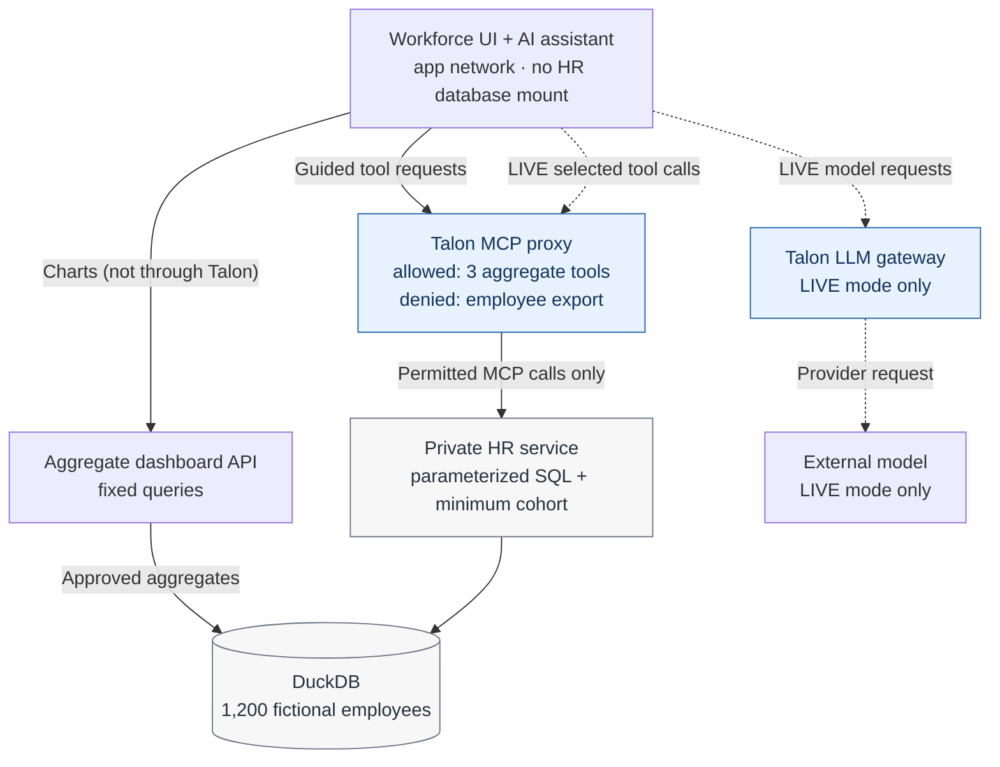

# People Analytics Copilot

**A realistic HR analytics application with a governed AI boundary.** This standalone demo uses 1,200 fictional employee records in DuckDB. It shows how an AI use case can perform useful aggregate analysis without gaining direct access to employee-level data.

Talon controls **model and tool traffic that passes through it**. Docker network isolation and the HR backend provide the other security boundaries.

## Get started

Use the reviewed branch of [Talon Full Demo](https://github.com/dativo-io/talon-full-demo):

~~~bash
git fetch origin
git switch feat/people-analytics-governed-demo
git pull --ff-only
talon version
docker compose version
bash scripts/people-analytics-isolated.sh up
~~~

Run these commands from the **repository root** on a trusted Linux host with Docker Compose v2, OpenSSL and a compatible Talon binary. No model-provider key is required.

The workforce app is at **http://127.0.0.1:8501**. If the host is remote, forward the port from your laptop:

~~~bash
ssh -N -L 8501:127.0.0.1:8501 user@demo-host
~~~

Choose your presentation style:

| Prefer clicking? | Prefer commands? |
|---|---|
| **[Browser playbook](UI_PLAYBOOK.md)** — workforce dashboard and authenticated operator console (port 8502) | **[Terminal playbook](PRESENTER_COMMANDS.md)** — raw Docker, Talon, HR counters and signed evidence |

Both interfaces execute **the same proof actions**. For the narrative, use the [15-minute presentation plan](PEOPLE_ANALYTICS_DEMO_PLAN.md).

To rehearse everything without clicking through the actions:

~~~bash
bash scripts/people-analytics-isolated.sh verify
~~~

**Do not mix this all-in-one rehearsal command with a live step-by-step presentation**: it performs its own baseline and counter reset.

Stop services with `bash scripts/people-analytics-isolated.sh down`. The separate `reset` command deletes synthetic HR data **and** Talon demo state.

## How the architecture works

**Who enforces what?**

| Boundary | Responsible component |
|---|---|
| AI application cannot contact the privileged HR service or open the HR database | **Docker network and volume isolation** |
| Agent sees and invokes only approved HR tools | **Talon policy and MCP proxy** |
| LIVE model requests are attributed and governed | **Talon LLM gateway** |
| Aggregate SQL, parameterization and minimum cohort size | **HR service** |
| Who can access production HR data | **Existing HR authorization**, not replaced by this demo |

The dashboard itself reads from a **separate, fixed aggregate service**; chart traffic is not governed by Talon.

## What the before/after demonstration means

1. **BEFORE:** A trusted, privileged HR process directly exports *fictional* employee details. This request **bypasses Talon** and succeeds.
2. **RESET:** Clear synthetic backend execution counters to zero. **No permissions change.**
3. **AFTER:** A *different, isolated* AI workload can fetch approved aggregates through Talon but cannot directly reach the privileged HR backend. A deliberately forced employee-export request through Talon is **denied before dispatch**.
4. **VERIFY:** Inspect the independent backend export counter (**zero since reset**) and verify Talon's signed evidence.

This is **not a Talon on/off switch or migration of the same agent**. The direct BEFORE call does not appear in Talon evidence because Talon never saw it. The negative test is an **operator probe**, not an autonomous model attempting the export.

## Guided versus live AI

| Mode | What is real | Extra setup |
|---|---|---|
| **GUIDED** — default | DuckDB metrics, Talon MCP allow/deny, signed evidence; **deterministic assistant, no LLM** | None |
| **Mock-provider integration** | Real Talon LLM + MCP gateways; a deterministic *fake* model emits a tool call | `bash scripts/test-people-analytics-talon.sh` |
| **LIVE** — optional | Actual external model via Talon gateway, governed MCP calls | Provider credential; first run the paid smoke test in [Advanced setup](ADVANCED_SETUP.md) |

**The LIVE provider path has not been executed against a real external model in mandatory CI.** Do not present mock-provider or guided responses as model-generated.

## More information

- [Browser playbook](UI_PLAYBOOK.md) · [Terminal playbook](PRESENTER_COMMANDS.md)
- [15-minute presentation plan](PEOPLE_ANALYTICS_DEMO_PLAN.md)
- [Advanced setup, standalone processes and LIVE model](ADVANCED_SETUP.md)
- [CI coverage and limitations](CI_COVERAGE.md)

The synthetic generator and Plotly helpers are reused from [franciscomorenosys/hr-data-pipeline](https://github.com/franciscomorenosys/hr-data-pipeline), MIT licensed, pinned to commit `f0edfe24f2e29d02b4145e9e806c3ad0826b7f5b`. The license is retained in [upstream_hr/LICENSE](upstream_hr/LICENSE). DuckDB aggregates and Talon integration are implemented in this demo.

**Scope:** fictional data only; no production identity, Workday integration, formal privacy certification or universal PII protection. PII redaction is off; signed evidence covers only traffic through Talon. Do not expose the operator console to the public internet.
