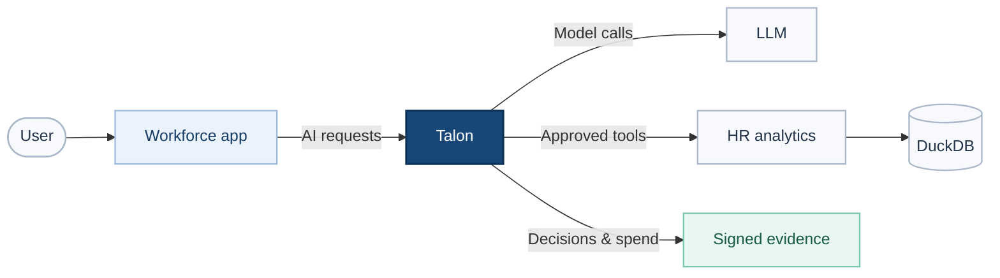
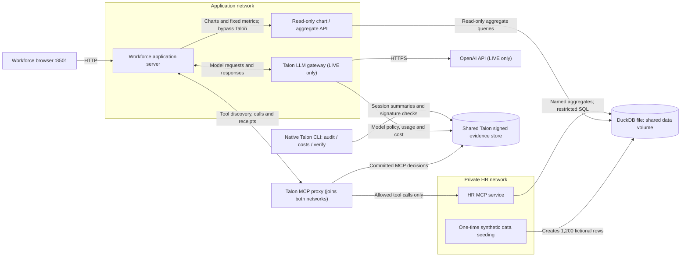
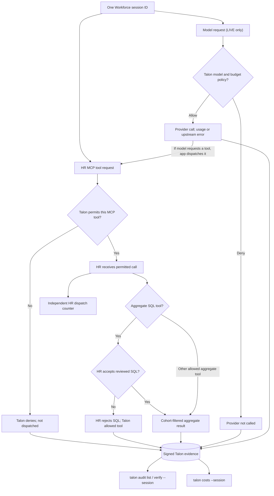

# Add Talon to a People Analytics application

## Talon at a glance



**What changes with Talon:** AI model calls and HR tool requests run through its policy boundary. Talon can allow aggregate analysis, deny the individual-employee export tool, and record signed decisions and session spend. The existing charts use a separate read-only analytics path and **do not** go through Talon. Talon never queries DuckDB directly.

This example begins with an ordinary workforce application: **DuckDB** stores 1,200 fictional employee records, a read-only analytics API serves the charts, and the application can ask an LLM about workforce trends. The next step is to control which models and HR operations its AI functionality can use.

Talon is introduced **between the application and its model/MCP endpoints**. We keep the database and chart API as they are; we do not give the AI application raw DuckDB access.

## The existing application



This shows the **server-side** boundaries, not direct browser connections to OpenAI or the HR backend. The browser reaches only the Workforce application on port 8501. The fixed chart API reads the DuckDB **file** via a read-only Docker volume without Talon. DuckDB is embedded, not a network database; the private HR service reads the same volume. The Talon MCP proxy is the only application-side service connected to the private HR network. Talon governs intercepted model requests and MCP capabilities, while the HR backend independently validates SQL. The gateway runs only in LIVE mode (the GUIDED path makes no model requests); credential-free CI uses a fake provider instead of external OpenAI. The two Talon processes share persisted signed evidence; `talon audit` and `talon costs` read that evidence, not browser-generated totals.

All employee records are fictional. Run the commands below from a trusted Linux host with Docker Compose v2, OpenSSL, and a compatible Talon binary installed (for example, `go install github.com/dativo-io/talon/cmd/talon@latest`).

## 1. Start DuckDB and the existing analytics services

From the demo repository:

```bash
cd cases/people-analytics-copilot
export HR_DEMO_TALON_BIN="$(command -v talon)"

# Local secrets for the Talon vault, audit signatures and admin access.
# .env is ignored by Git; it contains no OpenAI key.
umask 077
printf 'HR_DEMO_SECRETS_KEY=%s\nHR_DEMO_SIGNING_KEY=%s\nHR_DEMO_ADMIN_KEY=%s\nHR_DEMO_UID=%s\nHR_DEMO_GID=%s\n' \
  "$(openssl rand -hex 32)" "$(openssl rand -hex 32)" "$(openssl rand -hex 24)" "$(id -u)" "$(id -g)" > .env

mkdir -p .state/policy .state/talon
docker compose -f compose.isolated.yaml up --build -d seed hr-server dashboard
docker compose -f compose.isolated.yaml exec -T hr-server python3 warehouse.py status
```

DuckDB is an **embedded file**, not a database server. The `hr-server` service has read-only access to it; the separate `dashboard` service exposes fixed aggregate charts. At this point, the LLM/MCP portion has not been connected to Talon.

## 2. Initialize Talon and configure the AI use case

We use Docker to put the Talon CLI on the correct application network, running under your host UID so the generated files remain editable. The commands themselves are the **normal Talon CLI**, not an initialization script.

```bash
docker compose -f compose.isolated.yaml run --rm talon-cli talon init --scaffold --name hr-analytics-assistant

# The scaffold is real. Start with the app-specific example policies, then edit them.
cp agent.talon.yaml .state/talon/agent.talon.yaml
cp proxy.isolated.talon.yaml .state/policy/proxy.isolated.talon.yaml
cp gateway.talon.yaml .state/policy/gateway.talon.yaml
${EDITOR:-vi} .state/talon/agent.talon.yaml
${EDITOR:-vi} .state/policy/proxy.isolated.talon.yaml

docker compose -f compose.isolated.yaml run --rm talon-cli talon validate
docker compose -f compose.isolated.yaml run --rm talon-cli talon secrets set \
  hr-analytics-assistant-talon-key talon-hr-demo-key-0001
```

The three relevant files are:

| File | Why it exists |
|---|---|
| `.state/talon/agent.talon.yaml` | Agent identity, tool capabilities, model routing, budgets and audit settings |
| `.state/policy/proxy.isolated.talon.yaml` | Which MCP tools can reach the private HR service |
| `.state/policy/gateway.talon.yaml` | OpenAI endpoint and secret name for model requests |

The choices matter because they change behavior. In `agent.talon.yaml`, `agent.key.secret_name` binds requests to this AI use case; `capabilities.allowed_tools` names the capabilities it is meant to have; `policies.cost_limits` bounds per-request, daily and monthly model expenditure; `policies.session_limits.max_cost: 0.10` caps spending by the browser's Talon session (in the configured pricing currency); and `audit.include_prompts: false` avoids storing raw prompts. In the MCP proxy YAML, `proxy.allowed_tools` limits what can actually reach the HR backend, while `proxy.forbidden_tools` explicitly blocks `hr_employee_export`. The gateway file names the OpenAI endpoint and its **vault secret reference**, rather than embedding the provider key.

These restrictions are complementary: the SQL tool is callable only when Talon allows it, and the HR service independently accepts two standard department-count aggregates plus a strictly limited `department LIKE '%Customer%'` filter. The filter is bound as a SQL parameter, subject to minimum-cohort enforcement. Arbitrary SQL, joins, employee-level projections and additional clauses are not accepted.

If you want genuine OpenAI inference, enter a **disposable API key** and store it in Talon's encrypted vault:

```bash
read -rs -p "OpenAI API key: " OPENAI_API_KEY; echo
docker compose -f compose.isolated.yaml run --rm talon-cli talon secrets set openai-api-key "$OPENAI_API_KEY"
unset OPENAI_API_KEY
```

The CLI's `secrets set` command accepts a positional value: Docker administrators may see the argument while the setup container runs. Use this convenience path only with synthetic data and a disposable key, not production HR credentials.

## 3. Start Talon and connect the application

The Talon containers use a small Debian image with the system `ca-certificates` bundle. The bare `debian:bookworm-slim` image does not reliably provide that bundle, which can cause OpenAI requests to fail with `x509: certificate signed by unknown authority`. Rebuild Talon's image after upgrading. If your network intercepts HTTPS, install your organization's trusted root CA **in addition** to the standard CA bundle; never turn TLS verification off.

For real model calls, start the MCP proxy and LLM gateway **in the foreground** so their actual `talon serve` output remains visible:

```bash
docker compose -f compose.isolated.yaml --profile live up --build --force-recreate talon-mcp talon-gateway
```

In another terminal, from this same directory and with `HR_DEMO_TALON_BIN` exported:

```bash
export HR_DEMO_TALON_BIN="$(command -v talon)"
HR_DEMO_AI_MODE=live docker compose -f compose.isolated.yaml up --no-deps -d ui
```

Open **http://127.0.0.1:8501**. Its charts remain backed by DuckDB. SQL requests invoke the `hr_aggregate_sql` MCP tool through Talon, and AI questions use Talon's OpenAI-compatible gateway.

You can also follow the HR backend and application traces with `docker compose -f compose.isolated.yaml logs -f hr-server ui`. The actual Talon commands are declared in `compose.isolated.yaml`: `talon serve --proxy-config ...` and `talon serve --gateway --gateway-config ...`.

This includes Talon process output and the application's separately labeled `HR_AI_TRACE` events. The latter describe requests observed at the application/Talon boundary, **not** a packet capture inside OpenAI. Full prompt and response bodies are not logged by default.

No OpenAI key? Start `talon-mcp` alone, then start `ui` with the default **GUIDED · NO LLM** mode. SQL/MCP policy and signed evidence are still real, but the guided assistant uses deterministic wording. Don't present guided results as model-generated.

### Demonstrate a policy flip: deny → allow employee export

The upstream HR MCP server already defines `hr_employee_export`, which returns **at most eight fictional employee records**. The example agent capability list includes the tool; the **default MCP proxy** forbids it. The application does not override Talon's tool discovery or hardcode an employee-access refusal.

To enable the tool, edit `.state/policy/proxy.isolated.talon.yaml` (not just the checked-in example): **move** `hr_employee_export` from `forbidden_tools` into `allowed_tools`:

```yaml
  allowed_tools:
    - name: hr_attrition_summary
    - name: hr_headcount_summary
    - name: hr_tenure_summary
    - name: hr_aggregate_sql
    - name: hr_employee_export
  forbidden_tools: []
```

Make sure `.state/talon/agent.talon.yaml` also includes `hr_employee_export` under `capabilities.allowed_tools` (the revised checked-in example does). Recreate the MCP proxy to load the edited policy:

```bash
docker compose -f compose.isolated.yaml run --rm talon-cli talon validate
docker compose -f compose.isolated.yaml up --no-deps -d --force-recreate talon-mcp
```

Refresh the Workforce page and click **Request individual employee records**. You should now see an **ALLOWED** receipt and the returned fictional rows. In LIVE mode, ask for an individual record; the LLM can discover and call the export tool, though model tool selection is not guaranteed. The button gives a deterministic end-to-end tool execution check independent of model selection. Restore the original proxy policy to show **BLOCKED / not dispatched** again.

This is strictly a synthetic demonstration. Never enable this export tool against real employee data without independent HR authorization and identity checks.

## 4. Explore workforce analytics and see what policy changes

The workforce application can answer several useful questions without exposing employee-level rows:

| Workforce question | Application path | What happens with the example Talon policy |
|---|---|---|
| How is the workforce distributed across departments? | **All employees** SQL preset → `hr_aggregate_sql` | Talon allows the MCP tool; the HR backend returns department counts (cohorts of at least 10). |
| How many active employees are in each department? | **Active employees** SQL preset → `hr_aggregate_sql` | Talon allows; the HR backend returns active headcount by department. |
| How many active employees work in customer-facing departments? | **Customer departments** SQL preset → `hr_aggregate_sql` | Talon allows; the HR backend applies a bounded, parameterized `department LIKE '%Customer%'` filter. |
| Which departments had the highest attrition over the last six months? | **Workforce AI** → `hr_attrition_summary` | The aggregate tool is available. In LIVE mode, the model can request it through Talon; GUIDED mode uses it without an LLM. |
| Can I retrieve individual employees' names and salaries? | Employee-level SQL in the **SQL workspace** | Talon can allow the tool call, but **HR rejects the SQL**. The separate `hr_employee_export` MCP tool is explicitly forbidden by Talon. |

For example, the Customer departments query is:

```sql
SELECT department, COUNT(*) AS active_headcount
FROM employees
WHERE termination_date IS NULL
  AND department LIKE '%Customer%'
GROUP BY department
ORDER BY department;
```

It is not general-purpose SQL access: the HR backend accepts only the reviewed aggregate shapes, binds the department filter as data, and suppresses groups below the minimum cohort size.

### Change one permission; keep the application and queries unchanged

Suppose the workforce team decides that its AI application should still analyze attrition but should **no longer submit SQL**. In `.state/policy/proxy.isolated.talon.yaml`, remove this entry from `proxy.allowed_tools`:

```yaml
    - name: hr_aggregate_sql
```

Revalidate the agent policy and restart the Talon MCP service to load the edited proxy configuration:

```bash
docker compose -f compose.isolated.yaml run --rm talon-cli talon validate
docker compose -f compose.isolated.yaml up --no-deps -d --force-recreate talon-mcp
```

Now compare the same requests:

| Request | Before: SQL tool permitted | After: SQL tool removed |
|---|---|---|
| Department distribution SQL | Allowed; counts returned | **Talon denies before HR dispatch** |
| Active headcount SQL | Allowed; counts returned | **Talon denies before HR dispatch** |
| Customer department SQL | Allowed; filtered counts returned | **Talon denies before HR dispatch** |
| Six-month attrition using `hr_attrition_summary` | Still permitted | **Still permitted**; this tool was not removed |
| Existing dashboard charts | Render from the fixed aggregate API | **Unchanged**; chart traffic does not go through Talon |
| Employee-level SQL | **HR validator rejects** an authorized tool dispatch | **Talon denies** the tool call before HR can validate it |

This is the key distinction: **Talon controls which intercepted operations the AI application can invoke; the HR service controls which SQL those operations may execute.** Talon does not inspect an arbitrary SQL statement and determine whether it is safe. A denial from Talon carries a committed `not_dispatched` evidence record, and the HR backend's execution counter does not increase.

Restore the `hr_aggregate_sql` entry and recreate `talon-mcp` to permit the same queries again. No changes to the workforce application's code, DuckDB data, or chart API are needed.

## 5. Business observability: access, spend and tools

Instead of relying on infrastructure log lines, inspect **what this AI use case was allowed to do, what it was stopped from doing, and what its model calls cost**. Talon records the decisions and cost facts in signed evidence, which its native CLI aggregates by the session ID shown in the Workforce application.

### How an action becomes an observable business outcome



The **employee-export example** follows the first denied branch: the application explicitly attempts `hr_employee_export`, Talon denies before the HR backend receives it, and the HR dispatch counter stays unchanged. The model is *not* offered this forbidden tool, so this does not claim that an LLM independently selected it or that Talon parsed a salary query. An unauthorized SQL shape follows a different branch: Talon allows `hr_aggregate_sql`, then **HR** rejects the SQL; Talon has recorded an allowed tool dispatch, not an HR validation decision. The model/budget branch applies only in LIVE mode. Talon's signed records provide the session's tool decisions and cost data, and the HR counter independently confirms whether a tool call reached the backend.

### Individual employee data: a real denied tool request

1. Open the single Workforce application and use **Run SQL through Talon** for a valid department aggregate. Its Talon receipt is `allow`; the HR backend executes an approved aggregate.
2. Click **Request individual employee records**. The application attempts `hr_employee_export` through Talon's MCP endpoint with the **same session identity**. The capability is forbidden in `proxy.isolated.talon.yaml`.
3. The screen must show **BLOCKED**, `hr_employee_export`, `deny`, `not_dispatched`, a committed Talon evidence ID, and **no employee rows**. Independently check that HR's `hr_employee_export` counter did not increase.

This is **genuine Talon tool authorization**, not simulated text. Talon recognizes the *forbidden MCP capability* and prevents execution; it is **not** interpreting an arbitrary SQL statement, inferring malicious intent from a natural-language prompt or autonomously detecting employee data in the database. An individual-salary `SELECT` sent through the allowed SQL tool is rejected **by HR's SQL validator**, not by Talon. The explicit button is an application-initiated request, **not a claim that OpenAI chose the forbidden tool**.

### The session's business outcomes

Run these native Talon commands from `cases/people-analytics-copilot`. Use the session shown in the browser, not a `correlation_id` taken from an individual request:

```bash
SESSION=hr-demo-REPLACE-WITH-SESSION-FROM-BROWSER

# Signed-evidence rollup: spend, tokens, decisions, tool names and intervention reasons
docker compose -f compose.isolated.yaml run --rm talon-cli \
  talon audit list --session "$SESSION"

# The same evidence-backed cost rollup in a machine-readable form
docker compose -f compose.isolated.yaml run --rm talon-cli \
  talon costs --session "$SESSION" --json

# Independently verify that every evidence record in the session remains intact
docker compose -f compose.isolated.yaml run --rm talon-cli \
  talon audit verify --session "$SESSION"

# The HR backend can confirm that the denied export never executed
docker compose -f compose.isolated.yaml exec -T hr-server \
  python3 verify_isolation.py counters
```

| What a business owner wants to know | Native Talon evidence to check |
|---|---|
| Did the application attempt to obtain individual salary records? | `hr_employee_export` tool-call record with `allowed=false`, policy reason, and committed evidence ID. The separate app-request log confirms the intent that triggered it. |
| Were individual records actually exposed? | Talon `not_dispatched` plus an unchanged HR `hr_employee_export` counter proves this **intercepted route** never executed. It does not prove that no unrelated bypass exists. |
| What tools were available versus invoked? | Tool discovery omits `hr_employee_export`; the session rollup lists intercepted `tool_calls`, `tool_calls_denied`, and `tool_names`. The browser shows recent committed allowed/denied tool receipts. A discovered tool is not necessarily executed. |
| What did this interaction cost? | `talon costs --session "$SESSION" --json` returns evidence-derived `total_cost`, `currency`, `input_tokens`, `output_tokens` and related session statistics. In GUIDED mode there are no real model calls, so model spend should be zero. |
| What budget constrained that spending? | The loaded `agent.talon.yaml` example enforces a **per-session** cap of `0.10`, in addition to per-request, daily and monthly caps. This cap is configuration, **not** an amount to fabricate from logs. A genuine `session_budget_exceeded` decision must appear in evidence if the limit is reached. |
| Was the operation rejected by Talon or the backend? | A Talon `deny` / `not_dispatched` is a policy block. An `allow` receipt followed by `HR_SQL_REJECTED` is a backend validation failure. Keep those outcomes separate in any report. |

Talon's session rollup includes model/provider attribution, accumulated spend, token counts, allow/deny totals, denied reasons, and intercepted MCP tool counts. **Tool availability**, **tool invocations**, and **actual backend execution** are different measurements. A historical session may contain earlier activity: use a new browser session to isolate a new run. The session ID is client-asserted attribution rather than user authentication.

To explore a budget denial, change only `policies.session_limits.max_cost` in the agent YAML to a deliberately low *positive* limit, let Talon reload it, then make a new LIVE model request with a new browser session. Expect a `session_budget_exceeded` denial only **if the model gateway's priced pre-request estimate exceeds the effective cap**. The session's signed evidence will record the actual outcome; do not claim a denial if no priced request occurred. An unknown model price, an untrusted provider, or a failed upstream call requires separate investigation.

## 6. Read Talon's runtime logs

The MCP proxy and LLM gateway emit structured logs about **which Talon service is running, which AI use case issued a request, where a governed operation was directed, and whether operational metrics are caught up with persisted evidence**. These logs are useful for understanding the AI application's execution path; they are not a substitute for policy receipts, signed evidence, model traces or downstream execution counters.

From the application directory, follow Talon's logs and the application's own trace separately:

```bash
docker compose -f compose.isolated.yaml logs -f talon-mcp talon-gateway
docker compose -f compose.isolated.yaml logs -f ui hr-server
```

### What the startup lines mean

| Log field / event | Meaning in this application |
|---|---|
| `agent_config_reload_enabled interval=30000 source=/state/agent.talon.yaml` | Talon enabled polling of the **agent** configuration every 30,000 milliseconds (30 seconds). It does not mean a policy change occurred. The separate MCP **proxy** YAML is loaded when the proxy service starts; after editing that file, recreate `talon-mcp` as described above. |
| `agent_identity_registry_loaded agents=1 tenants=1` | Talon's identity registry loaded one agent and one tenant scope. This is not a count of human users or open workforce sessions. |
| `talon_serve_started addr=0.0.0.0:8080 ... gateway=false mcp_proxy=true` | The MCP proxy is listening on **container** port 8080. It controls HR tool discovery and invocation. |
| `talon_serve_started addr=0.0.0.0:8082 ... gateway=true mcp_proxy=false` | A separate service is listening on **container** port 8082 for model traffic. `dashboard=true` / `gateway_dashboard=true` refer to Talon's own runtime dashboard/metrics capability, not a second Workforce application on port 8501. |
| `openshell_middleware=false` / `cron_entries=0` | Those Talon runtime features are not active in this example; neither field is an error. |

### Follow a request through the harness

These are abbreviated examples of the actual log shapes; IDs vary on each request:

```text
talon-mcp      INF data_flow_recorded agent_id=hr-analytics-assistant correlation_id=mcp_proxy_bf80eb46 flow_destination=mcp_tool:fictional-hr-warehouse flow_items=1 flow_region=unknown tenant_id=default
talon-gateway  INF data_flow_recorded agent_id=hr-analytics-assistant correlation_id=gw_3fb86b9d-6d5 flow_destinations=llm_provider:openai flow_items=1 flow_regions=US tenant_id=default
```

| Field | What it means — and what it does **not** prove |
|---|---|
| `data_flow_recorded` | Talon constructed a data-flow observation for this routed request and emitted its metadata. It is **not proof that the destination accepted the request or that the operation succeeded**. Read the decision, status, provider errors and signed evidence to establish the outcome. |
| `correlation_id` | ID for a **single Talon request**. The MCP proxy accepts a validated `X-Correlation-ID` or generates an `mcp_proxy_...` ID; the gateway has its own `gw_...` IDs. Different calls from one Workforce AI question normally have **different** correlation IDs. |
| `agent_id=hr-analytics-assistant` | The Talon agent identity attributed to the request, derived from the authenticated request context or proxy configuration as applicable. It is not an employee ID. |
| `tenant_id=default` | This local example is running in Talon's default tenant scope. It does not demonstrate production multi-tenant provisioning or access controls. |
| `flow_destination=mcp_tool:fictional-hr-warehouse` | The logical MCP upstream named in the proxy policy. It does not say which SQL query ran, whether it passed HR validation, or how many rows were returned. |
| `flow_destinations=llm_provider:openai` | The configured model-provider destination for the recorded flow. It is not confirmation that OpenAI received or processed the request: an HTTPS/TLS error can follow the same log event. |
| `flow_items=1` | One structured **data-flow item** was recorded (e.g. a request-to-destination relationship). It is **not** one HR record, model token, tool call, or successful network delivery. |
| `flow_region=unknown` | No trustworthy HR-upstream region was resolved from the available metadata. It does not mean the HR data moved to an unknown jurisdiction. |
| `flow_regions=US` | Talon resolved US as the provider's configured/registered jurisdiction metadata. This is **not independent network-geolocation evidence**, a processing-location guarantee, or a GDPR compliance conclusion. |

To connect the whole AI interaction, use the **session ID**, not the per-request correlation ID. The Workforce browser generates a `hr-demo-...` session ID and sends it as `X-Talon-Session-ID` on its MCP and LLM requests. Talon records this for grouping; it is **client-asserted attribution, not authentication or a policy decision input**. A single browser session may contain many model requests, tool calls and independent `correlation_id` values.

The application's separately prefixed `HR_AI_TRACE` records describe events it observed, such as `mcp.request`, `mcp.response`, `llm.gateway.request` and `llm.gateway.response`. These events can show the model name, offered tools, selected tool names, usage when supplied, and associated evidence IDs. They are **application observations**, not Talon security decisions or packet captures from OpenAI. By default they exclude prompt/response payloads.

### Why does `metrics_reconcile_recovered recovered_events=5` appear?

```text
talon-gateway INF metrics_reconcile_recovered recovered_events=5
```

Talon persists signed evidence as the system of record, and its dashboard/metrics collector maintains a faster in-memory projection. By default, approximately every **30 seconds**, reconciliation rebuilds the projection from a bounded evidence-store window (default **24 hours**, up to **10,000** records). The `recovered_events` value is the **positive difference between the rebuilt request count and the collector count immediately before the rebuild**. It does **not** mean five failed requests, five extra OpenAI calls, or five newly discovered security violations. Reconciliation is designed to be idempotent, so the same evidence is not counted twice merely by replaying it.

Here, `talon-mcp` and `talon-gateway` are separate processes using the **same persisted Talon state directory**. Each process's live in-memory collector can observe its own evidence commits, while the gateway's periodic reconciliation can pick up evidence committed by the MCP process. That is a **likely explanation** for nonzero counts such as `5`, `2`, `4` during active testing; these lines alone cannot identify precisely which records were recovered.

Repeated recovery does not automatically indicate data loss. If it continues unexpectedly when traffic is idle, or if dashboard numbers differ from audit evidence, inspect collector health: `metrics_collector_event_dropped` warnings, `dropped_events` in `/api/v1/metrics`, and `metrics_events_dropped` / reconcile status in `/v1/status`. A `metrics_reconcile_failed` warning warrants investigation. The metrics projection is not a replacement for the signed evidence store.

### Establish the actual outcome, not just the log line

Use the session value shown in the workforce app (replace the example ID with your own):

```bash
docker compose -f compose.isolated.yaml run --rm talon-cli \
  talon audit list --session hr-demo-EXAMPLE

docker compose -f compose.isolated.yaml run --rm talon-cli \
  talon audit verify --session hr-demo-EXAMPLE
```

To inspect an individual decision, run `talon audit show <evidence-id>` or `talon audit verify <evidence-id>` with the same `docker compose ... run --rm talon-cli` prefix. For the HR side, compare its independent tool-dispatch counters:

```bash
docker compose -f compose.isolated.yaml exec -T hr-server \
  python3 verify_isolation.py counters
```

**How to interpret the combined proof:** a Talon `deny` with `not_dispatched` and a committed evidence record, plus no increase in the HR counter, demonstrates an intercepted tool was stopped before reaching the backend. A Talon `allow` only authorizes dispatch: an HR SQL rejection or upstream TLS error is a separate outcome. A successful response must be confirmed independently of the `data_flow_recorded` log.

For distributed traces beyond these local log lines, Talon supports optional OpenTelemetry (`TALON_OTEL_ENABLED=true`), with `trace_id` / `span_id` on supported instrumented log events. The short `correlation_id`, application `session_id`, and OTel trace ID are **different identifiers**. See the [Talon observability reference](https://github.com/dativo-io/talon/blob/main/docs/OBSERVABILITY.md) for exported metrics and traces.

## 7. Inspect the evidence

Use the native Talon audit commands:

```bash
docker compose -f compose.isolated.yaml run --rm talon-cli talon audit list
# Copy an evidence ID from a real allow/deny response:
docker compose -f compose.isolated.yaml run --rm talon-cli talon audit verify EVIDENCE_ID
```

The HR backend's independent execution counters are available with:

```bash
docker compose -f compose.isolated.yaml exec -T hr-server python3 verify_isolation.py counters
```

A denied MCP tool must have a signed **not-dispatched** receipt and must **not** increment the backend's execution counter. Calls that bypass Talon have no Talon evidence.

To stop the stack: `docker compose -f compose.isolated.yaml --profile live down`. The local `.state/` directory persists the Talon vault and evidence; deleting it destroys that local demo state.

## Tests and limitations

[Automated test coverage](CI_COVERAGE.md) includes Docker isolation, real Talon CLI/MCP behavior, Chromium and an actual allow→deny→allow policy edit. The external-provider check is opt-in and billable: from the repository root run `bash scripts/test-people-analytics-real-provider.sh` with `OPENAI_API_KEY` set.

This sample does not provide production HR IAM, row-level permissions, general SQL analysis, comprehensive PII protection or legal compliance determinations. Signed evidence is tamper-evident as long as the signing key is protected. The synthetic data/Plotly components come from [franciscomorenosys/hr-data-pipeline](https://github.com/franciscomorenosys/hr-data-pipeline), MIT licensed, commit `f0edfe24f2e29d02b4145e9e806c3ad0826b7f5b`; see `upstream_hr/LICENSE`.
