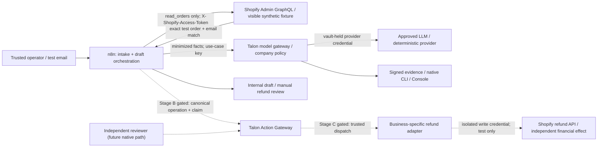

# Shopify AI customer support — read, draft and refund handoff

**Stage A released-artifact synthetic test + Stage B development-only synthetic integration.** This is the existing ACME customer-support use case in an e-commerce setting, not another use case or a standalone authorization system. The standalone `shopify-support.workflow.json` remains an inactive, read/draft-only stock-node export; by itself it cannot send email or dispatch financial actions. The source-main integration harness *also imports the official canonical n8n refund workflow* under the **same native customer-support Talon key**, passes actual verified draft outputs to a trusted synthetic caller and proves company allow/deny/independent approval against a counting synthetic refund adapter. This second path passed in [CI run 44826296354](https://github.com/dativo-io/talon-full-demo/actions/runs/44826296354), using **source-built** pinned Talon main and n8n 2.48.5. It is not a completed one-click joined community template or published v1.17.0 customer acceptance. Actual Shopify mutations, paid inference and Stage C are NOT implemented or tested.

## Skeptical buyer proof — why not an established gateway?

**The buying problem is not "can AI draft a support answer?"** A customer running Bifrost or LiteLLM already has models, budgets, MCP policy and routing. Portkey offers an agent registry and central policy. Solo.io can apply MCP/HTTP guardrails and ext-auth; TrueFoundry has native MCP human approval. Talon has to show the company can adopt an **existing** support app and authorize a consequential **business operation** with less additional operational code and risk.

| Rival | What it already contributes | Required Talon differentiation, not assumed superiority |
| --- | --- | --- |
| Bifrost (Maxim AI) | MCP gateway/tool execution, policies and audit; approval depending on capability/edition | Exact typed **refund operation** lifecycle, durable independent claim/UNKNOWN, independent counted result; reduce per-app custom plumbing |
| LiteLLM | Virtual keys/team budgets/provider fallback/MCP access | Native linked model+business-action policy **without** needing the app team to build its own approval/operation store |
| Portkey | Agent registry, org policy, tool control and operational traces | Concrete time-to-second-use-case and exact policy-to-dispatch/effect proof |
| Solo.io agentgateway | HTTP/MCP authorization and enterprise argument guardrails, ext-auth to custom policy service | Fewer independently operated ext-auth/reviewer/dispatch/state services with comparable correctness |
| TrueFoundry | MCP tool approval and agent identity | Show approval itself never dispatches, exact argument binding, durable claim, retry/UNKNOWN, independent merchant result |

### Procurement acceptance, not a happy-path video

1. **Customer value:** actual support case and verified synthetic order data, a helpful response draft, explicit human handoff; unverified sender and ambiguous order are rejected, raw email/payment details do not flow to provider.
2. **Two distinct policy surfaces:** actual Talon model routing and generic trusted **Action Gateway**. The approved demo uses a read/draft n8n graph plus the official action n8n graph, the same native Talon key and process; not a single installed standalone combined template. A read-only Shopify lookup is **outside Talon** and may be outside the gateway path.
3. **Exact action lifecycle:** only an independently merchant-eligible synthetic order can reach trusted dispatch; company €25 allow / €249 independent review / €750 deny; company rule cannot be weakened by app policy. Zero downstream before and immediately on reviewer approval, one after a separate claim; signed operation and 2-call fake ledger.
4. **Failure and negative cases:** malformed/wrong currency and missing typed arguments, €50/50.01/500/500.01 bands, changed arguments, replay/concurrent claims, unauthorized reviewer, restart and `UNKNOWN` reconciliation. Do not confuse the upstream reference's standalone UNKNOWN suite with this same Shopify ticket.
5. **Release and adoption:** verify the official published release artifact hash and n8n compatibility, exact current version/identity, source-of-truth company policy, re-import credentials (never in export), one other independently governed existing use case and seven-area read-only Console correlation. No external financial mutation during a general buyer demo.

**Existing proof:** source-main real-n8n + synthetic Shopify/provider/finance CI has passed a joined same-identity refund flow. **Not proven:** live Shopify store/test transactions, real mail sender identity, paid provider request, single export that installs both graphs, full native restore/replay across restart, end-to-end shared two-app fleet, published v1.17.0 acceptance. The latest PR check status must be consulted; a previously green run never overwrites a newer red check. A signed record is tamper-evident, not immutable; Talon at-most-once dispatch within its durable boundaries is not exactly-once external payment effect. The legacy bespoke approval server is not an alternative authorization path in this canonical demo.

**Sales rule:** First explain the ordinary support value, then show why the company operator trusts a bounded business action. If the buyer wants only AI drafting or model routing, LiteLLM/Bifrost/Portkey are credible simpler choices. Full positioning and evidence gates: [competitor scorecard](https://github.com/dativo-io/talon-full-demo/blob/docs/acme-release-aligned-showcase/docs/COMPETITOR_PROOF_SCORECARD.md) · [buyer-win strategy](https://github.com/dativo-io/talon-full-demo/blob/docs/acme-release-aligned-showcase/docs/TALON_BUYER_WIN_STRATEGY.md).

## Business journey

1. A support operator opens a customer email about order status, shipping delay, damaged/wrong products, returns or refunds. The committed Manual Trigger + editable sample stand in for a trusted intake; no Gmail trigger or proof of mailbox identity yet. Operator must verify the authenticated customer/requester out of band; never convert an email From header into a verification flag.
2. Parse the synthetic or attested test input, extract exactly one #order number and bounded issue hints; unsupported/ambiguous inputs go to manual review.
3. Read the order via Shopify Admin GraphQL with a dedicated read-only credential. Require one exact order, matching email, test=true and no GraphQL errors. Missing protected data, non-test orders or mismatches stop before model access.
4. Send only fixed structured issue hints, payment/fulfillment status and a screened decimal EUR proposal (if any) through the configured Talon model route; no raw customer email, body, order number, Shopify token or payment details in the model prompt. The original email remains with the support operator. This conservative first edition does not infer open-ended details; human review is required.
5. Validate the model's JSON classification, recommendation and draft. The amount screen is simple presentment-currency arithmetic, **not** eligibility or authorization. For unsupported, wrong currency, nonrefundable-looking or unverified inputs use manual review. Every output is an internal untrusted draft; no email send and no refund execution.
6. Inspect the actual Talon session and evidence by session ID; in stable v1.17.0, verify the **seven-area** read-only Operations Console (Overview, AI Use Cases, Approvals, Sessions, Costs, Configuration, System) against the same run. Costs and PII/failover claims must come from actual Talon records, not estimated application fields.

## Architecture and trust boundary



The current Stage A graph is solid arrows only. The joined source-main test imports the official canonical reference as a **second actual n8n workflow**; these dotted Stage B edges are tested with a synthetic finance adapter, not a Shopify payment integration. The exported Stage A workflow remains read/draft-only. Raw email and read lookup bypass Talon by design. The future adapter (not built) must be reachable only by authenticated Talon, with separate Shopify write access never in n8n. The model does not authorize. No separate approval server is used by this export; the existing legacy demo remains independently available as historical comparison until canonical replacement passes.

## Standalone setup and clean export

- n8n Stage A release-test target: **2.30.4** (existing repository pin). The canonical OSS #566 refund workflow was actually tested on **2.48.5**, not 2.30.4; do not silently present the two versions as equivalent. The core-main compatibility lane tests Stage A on 2.30.4 and the official Action Gateway example on 2.48.5 independently. This is not yet an integrated Stage A→B n8n execution. Import `shopify-support.workflow.json` from the n8n UI; no Full Demo checkout or Makefile needed for a configured real Shopify read-only path. All nodes are stock; no credential values in the JSON. Inactive by default.
- Prepare a running Talon installation with the existing customer-support operational identity, approved provider route and company data/cost policy; configure actual provider keys in Talon only. Use official published release artifacts, not source builds. The Stage A deterministic acceptance runner pins Linux/amd64 v1.16.1; it cannot certify v1.17.0 Console/Action Gateway. The complete stable v1.17.0 release is the final ACME target. RC.1 is incomplete.
- In n8n create Header Auth credentials for the two HTTP nodes: `X-Shopify-Access-Token` = read-only token from an installed Shopify app; `Authorization` = Bearer followed by the Talon use-case key. Rebind both after import. Do not store values in workflow code or export credential records.
- For the visible synthetic mode, start the co-packaged `fixture.py --port 19091 --log <disposable-path>` locally with Python 3. Connect Talon's OpenAI provider config to that fixture's base URL and vault the synthetic provider credential. The local runner provisions ephemeral synthetic tokens, policy and exact release binary; the endpoint has no mutation handler. These synthetic values are not suitable for any remote or shared host.
- For development-store read-only mode, obtain an installed app token scoped to `read_orders` (no write scope; confirm granted scopes). Shopify may require protected customer data access for Order.email; deny on missing permission. Select `development_store` in Operator settings, use an HTTPS `<store>.myshopify.com/admin/api/2026-10/graphql.json` endpoint, verified test-order requester, and set the trusted HTTPS Talon URL (or local loopback). Use only development-store test orders; no real customer data. Token expiry/renewal is operator-managed in this edition. No credentials supplied or real store tested here. API version/schema still requires a live development-store check.
- Set the input fields and execute the workflow manually. Review the output; do not enable automated sends. See the terminal node, inspect the matching actual Talon session in CLI, export signed JSON and verify (`talon audit export --format signed-json --session <session> --output evidence.json`, `talon audit verify --file evidence.json`). Validate actual version flags. No bypass or direct LLM API calls.
- The exported workflow disables normal execution-data retention; this is not a guarantee that n8n logs, editors, task runners or backups never contain data. Control access, encryption, log redaction and retention before real customer use. Do not export execution data or credentials to community templates.

### Verification

```bash
node workflow.test.cjs
bash test-n8n.sh  # Linux/amd64, Docker, curl, jq, Python 3, openssl
```

The first evaluates the actual exported Code nodes. The second downloads the exact v1.16.1 archive, verifies the pinned SHA256, runs actual Talon, imports into pinned n8n and executes the ordinary enquiry, clean re-import refund handoff and unauthorized sender cases. An additional **development-only** CI lane consumes a source-built pinned Talon core-main commit; it is not a substitute for a released binary. It asserts actual terminal node output, independent fixture/provider counts and exact-session Talon signature verification. No real Shopify, real provider, approval or financial effect. CI `Shopify support acceptance` must be green before making any claim of the released-artifact Stage A runtime pass. The separate `Shopify support against Talon current main (development only)` lane covers the source-main shared-identity action test and official reference negative tests, without claiming any stable artifact. Native Console, fallback, PII redaction (as distinct from local minimization), real costs, Shopify read and all Stage B/C gates remain NOT RUN or NOT IMPLEMENTED until separately verified. Import-to-first-governed-request <15 min on a configured host is a target, not measured.

## Stage B — native canonical action reference integrated in development-only synthetic acceptance

The [joined acceptance run](https://github.com/dativo-io/talon-full-demo/actions/runs/44826296354) verifies real n8n Stage A read/draft and the unmodified **official n8n action logic** imported as another workflow into the SAME actual Talon installation. The trusted synthetic caller checks Stage A's terminal outputs before constructing action requests for the same `SUP-1001` test ticket. Exact EUR amounts 25/249/750 are checked in the actual source-main Gateway: company deny above 500, use-case approval above 50, reviewer outside n8n, zero pending/approved-but-unclaimed dispatch, one claimed synthetic effect, replay and changed-argument conflict, verified operation lifecycles, and independent fake finance idempotency keys. The official upstream example's extended negative/UNKNOWN cases also pass in that same CI job, but under a **separate** reference fixture; do not claim its UNKNOWN was executed for this same Shopify ticket. The standalone Stage A export still contains no Action Gateway nodes; buyer presentation must show both real imported workflow graphs, not pretend one already includes the other. The integration harness is a test harness, not an autonomous merchant authorization step: merchant eligibility remains an independent domain check. Current source-main runtime has no monetary effects.

Customer acceptance still requires published complete stable v1.17.0, fixed artifact/image digests, secure persistent fleet configuration, Console/CLI parity, supported reviewer operations, verified second inherited use case, actual provider integration where claimed, recovery, full adapter/test-store permission review and consumer version compatibility. **Do not mark the First Production Pilot accepted from this one synthetic test.**

On Talon core `main` commit `5912dc1215ccfc27a90ede9366b41450450359ea`, #564 generic exact-decimal policy, #565 native reviewer and #566 official stock-node n8n workflow are **merged and tested upstream** ([real n8n 2.48.5 run](https://github.com/dativo-io/talon/actions/runs/44786799917)). They are not available in the current published stable v1.16.1; #569 pilot runbook and #568 production operations remain under review. Run `integrations/n8n/shopify-support/test-n8n.sh` for released Stage A; the development-only `.github/workflows/shopify-core-main.yml` builds this pinned main SHA, executes Stage A and official canonical refund workflow **in one Talon process with the same native customer-support identity**, verifies independent synthetic outcomes, and separately runs upstream canonical negative tests. **Neither upstream proof nor these separate jobs proves one joined Shopify app action path.** Use final stable v1.17.0 for customer acceptance. Reuse the actual official #566 stock-node workflow and #564 generic exact-decimal company rule, #565 native reviewer and #569 runbook once complete stable v1.17.0 is verified. Do not copy unreleased product policy or use the old approval service. Bind trusted order ID, ticket, exact EUR amount, currency and eligible transaction details to the operation and independent reviewer. Use a synthetic ledger with explicit results first. Required allow 25, approval 249 (zero before and on approval, one dispatch after claim), deny 750 zero dispatch, edges 50/50.01/500/500.01, malformed/missing inputs, company override, merchant invalid refund, replay, changed arguments, unauthorized reviewer, restart and UNKNOWN. The model's proposed resolution does not determine eligibility. Use actual registered/loaded/connected/governed evidence and shared baseline across HR/support. Talon at-most-once dispatch in durable state is not exactly-once external effects. No blind redispatch. Buyer and technical views must reference same execution and evidence.

## Stage C — Shopify integration research / design gate

Shopify official documents: [Order schema (2026-10)](https://shopify.dev/docs/api/admin-graphql/2026-10/objects/Order), [scopes](https://shopify.dev/docs/api/usage/access-scopes), [authentication](https://shopify.dev/docs/apps/build/authentication-authorization), [access tokens](https://shopify.dev/docs/apps/build/authentication-authorization/access-tokens), [dev stores](https://shopify.dev/docs/apps/build/stores/development-stores), [refundCreate](https://shopify.dev/docs/api/admin-graphql/latest/mutations/refundcreate), [idempotent requests](https://shopify.dev/docs/api/usage/idempotent-requests). In 2026-10 Admin API use `refundCreate(input: RefundInput!) @idempotent(key: ...) `; idempotency mandatory since 2026-04. The business adapter must use an installed Shopify app with least-privilege order write access (verify actual granted scope, protected data and staff permissions), isolated from n8n. Use test gateway/test transactions only; explicit developer authorization required before test refunds.

Read the order, original successful payment transactions, suggested refund, remaining refundable amounts and relevant return/line-item state. Derive stable Shopify idempotency key from the sealed Talon logical operation plus store identity in the durable adapter ledger. Verify currency and exact decimal, eligibility, unchanged bound order/transaction/details and balance at dispatch; fail closed when these changed; require new proposal/operation and reviewer if material changes. Construct `RefundInput` with order GID, eligible line items and/or refund transaction details (parent transaction GID, gateway, kind REFUND, exact amount, currency per schema); confirm pinned mutation schema and permissions against a dev store before coding. Never treat HTTP 200 or a refund ID alone as proven settled payment. Check top-level GraphQL errors, userErrors, actual refund/transaction status and independent Shopify query; pending/partial or lost response needs reconciliation, not blind retries. Store operation/idempotency key/argument hash and observed outcome with minimum personal data. Shopify owns financial effects; adapter maps business outcomes; Talon authorizes/dispatches. Confirm idempotency retention, ambiguous response semantics, full/partial transaction success, over-refund and currency constraints in test store. No actual Shopify mutation implemented or tested.

## Marketplace preview (not published)

**AI Shopify customer support with governed refund requests** — read-only/draft/handoff edition preview. Search terms: Shopify customer support, Gmail support automation (future), AI customer service, AI cost control, refund request review, OpenAI. Do not claim actual automated refunds/human approval until Stage B/C verified; do not claim Gmail trigger in current edition. Future verified title: Automate Shopify customer support with AI and policy-controlled refunds. Export and this setup guide can be consumed by a future template repository; synthetic fixture is explicit, not a hidden dependency. No new template repository or listing created.
